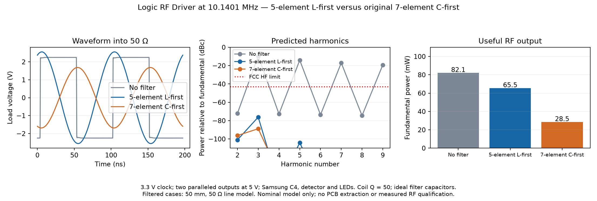

# Logic RF Driver with a 30 m low-pass filter

This circuit simulation drives a 50-ohm load at 10.1401 MHz with the board’s two directly paralleled outputs. The source includes the retained IBIS-derived behavioral output model, package parasitics, the Samsung C4 fit, RF detector, and both LED branches. It is a simulation of the circuit, not a physical measurement or a PCB electromagnetic extraction.

| Configuration | Fundamental | Third harmonic | Fifth harmonic | Modeled 5 V pull-up current | Channel peak |
| --- | ---: | ---: | ---: | ---: | ---: |
| No filter | 82.07 mW | -9.57 dBc | -14.03 dBc | 27.57 mA | 32.67 mA |
| 5-element L-first | 65.47 mW | -76.14 dBc | -104.00 dBc | 23.39 mA | 47.77 mA |
| 7-element C-first | 28.49 mW | -88.82 dBc | -125.57 dBc | 37.80 mA | 207.32 mA |

## Sensitivity checks

| Case | Fundamental | Third harmonic |
| --- | ---: | ---: |
| 5-element L-first; Q 25; 50 mm; step T/1400 | 52.281 mW | -75.177 dBc |
| 5-element L-first; Q 50; 50 mm; step T/1400 | 65.470 mW | -76.142 dBc |
| 5-element L-first; Q 100; 50 mm; step T/1400 | 73.314 mW | -76.629 dBc |
| 7-element C-first; Q 25; 50 mm; step T/1400 | 21.178 mW | -87.581 dBc |
| 7-element C-first; Q 50; 50 mm; step T/1400 | 28.491 mW | -88.823 dBc |
| 7-element C-first; Q 100; 50 mm; step T/1400 | 33.263 mW | -89.466 dBc |
| 5-element L-first; Q 50; 0 mm; step T/1400 | 65.718 mW | -76.076 dBc |
| 5-element L-first; Q 50; 200 mm; step T/1400 | 64.704 mW | -76.144 dBc |
| 7-element C-first; Q 50; 0 mm; step T/1400 | 28.511 mW | -90.970 dBc |
| 7-element C-first; Q 50; 200 mm; step T/1400 | 29.430 mW | -87.124 dBc |
| 5-element L-first; Q 50; 50 mm; step T/2800 | 65.467 mW | -76.120 dBc |
| 7-element C-first; Q 50; 50 mm; step T/2800 | 28.494 mW | -88.794 dBc |

Halving the maximum timestep changes 5-element L-first fundamental power by 0.00545% and third-harmonic level by 0.02190 dB.

Halving the maximum timestep changes 7-element C-first fundamental power by 0.01228% and third-harmonic level by 0.02878 dB.

The L-first filter uses the LPF-LCL minimum-loss 30/40 m targets: 1.5934 µH end inductors, a 2.2398 µH center inductor, and 325.75 pF at each shunt position. The seven-element C-first filter uses the original workbook values: 681 pF, 866 nH, 976 pF, 909 nH, 976 pF, 866 nH, and 681 pF. These are different filter orders and tuning choices: L-first is tuned to a carrier transmission maximum, while the C-first values retain the original workbook tuning. This is a comparison of the two specified designs, not an isolated test of which component comes first. Nominal coil Q is 50 at the carrier. The sensitivity cases use Q of 25 and 100, line lengths of zero and 200 mm, and half the maximum timestep. The nominal filtered cases use a 50 mm, 50-ohm lossless line represented by ten LC pi sections with a propagation velocity of 1.7 × 10^8 m/s. These line dimensions are assumptions, not a verified board stackup or external cable specification.

The filter is connected to the buffer through C4 without a source-matching resistor. The buffer’s output impedance follows its voltage-dependent pull-up and pull-down tables; it is not replaced with a 50-ohm generator. The clock timing uses the retained 3.3 V source model with an illustrative 50-ohm source resistance. It does not identify a specific GPIO drive setting.

## Model limits

The modeled output-pin peak and RMS currents appear in the result record. Large C-first charging-current pulses can lie outside a useful device qualification envelope. These behavioral sources do not enforce safe current or temperature limits; a completed numerical run does not establish that the real IC can sustain the predicted waveform. The L-first result also needs output-current and temperature checks on hardware.

The Samsung C4 network is the retained bias-dependent passive fit for 10 MHz, applied at 10.1401 MHz. Filter capacitors are ideal and coil ESR is fixed from Q at the operating frequency. Component self-resonance, mutual coupling, tolerance, mounting parasitics, connector loss, and extracted board copper are absent. Supply rails are ideal. The 5 V estimate includes modeled output pull-up current but omits internal crossover and switching current. The 3.3 V estimate covers the LEDs, excluding internal VCCA consumption and the clock-source supply.

The nominal source has 50% duty cycle and matched channel timing. Even harmonics and very deep modeled suppression do not bound real source asymmetry, component spread, layout coupling, or instrument limitations. These results do not establish FCC compliance or continuous-duty reliability.

## Reproduction and checks

Run `scripts/simulate_30m_filters.py` with `--research` pointing to the external helper and model dependencies used by the board study and `--output` pointing to an ignored generated directory. The retained board-rerun source deck and Samsung fit, plus the sibling LPF-LCL minimum-loss value table, are required. Raw decks, logs, and waveforms remain under the selected generated output directory. The optional `--reuse-l-first` argument retains the unchanged L-first and bare-load results only when source-deck, C4, filter-table, schematic, and PCB hashes match; their original raw runs remain in the referenced generated directory. Run `scripts/report_30m_filters.py` with `--research` and `--runs` to render this report and graph. The [result record](docs/30m-transmitter-results.json) includes all accepted sensitivity cases. No schematic, PCB, or BOM changes are part of this study.
