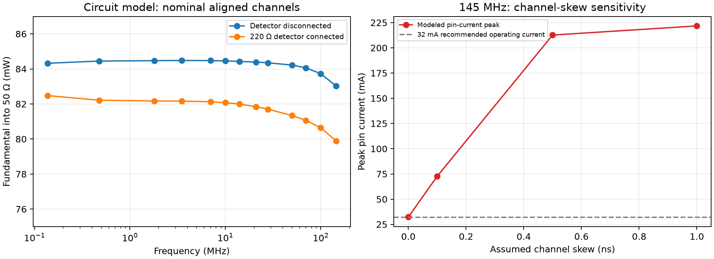

# Board circuit simulation

The nominal circuit model predicts 82.5 mW at 137 kHz and 79.9 mW at 145 MHz into 50 ohms with the 220-ohm detector connected. The activity LED draws about 1.72–1.79 mA. These are circuit-model predictions, not measured ratings or an electromagnetic simulation of the PCB.

The main concern is output-current margin. Even with aligned channels, modeled pin-current peaks reach 35.9 mA per channel. [TI specifies a recommended output-current magnitude of 32 mA at 4.5–5.5 V](https://www.ti.com/lit/ds/symlink/sn74lvc2t45.pdf). Brief simulated peaks cannot establish acceptable pulse operation, and RMS current below that value does not qualify the peaks. The model does not establish continuous operation across the target band.

## Circuit and conditions

The exported schematic netlist connects U1 A1/A2 to CLK_IN, B1/B2 directly together at RF_RAW, and DIR to 3.3 V. C4 couples RF_RAW to RF_OUT and the 50-ohm load. R2 is 220 ohms, C5/C6 are 10 nF, R3 is 1 Mohm, and R4/R5 are 680 ohms. The detector uses the RF_RAW tap. D2 indicates RF activity, and D3 indicates the 3.3 V rail. J1/J3 are Adafruit 1865 SMA connectors, and J2 is the shared terminal/header footprint. The [result record](docs/board-simulation-results.json) ties the calculation to hashes of the saved design and model inputs.

The source is a raw 0–3.3 V, 50% duty-cycle clock with 0.5 ns transitions and an illustrative 50-ohm source impedance. The timing surrogate represents the two logic inputs. U1 has ideal 3.3 V and 5 V rails, nominal IBIS-derived output tables, simplified package parasitics, and 2 pF of output-board capacitance. The Samsung C4 model uses the retained bias-dependent passive fit, linearized at about 2.515 V. Its initialized charge is adjusted for periodic operation; its network coefficients remain fixed within each transient.

Ngspice uses Gear integration at 25 C, reltol 0.0001, and abstol 1e-12. Each case runs for 60 clock periods and measures the final eight. Loaded cases search initial states for C5, C6, and C4's main capacitor. Their final 20-period state changes are below 50 microvolts. The primary sweep uses a maximum timestep of one period divided by 1400. Endpoint checks and the 0.1 ns skew check use one period divided by 2800.

## Frequency sweep

Power is the Fourier fundamental at the 50-ohm load, excluding filter and connector loss. Current peaks are the larger magnitude at either modeled output pin, including package and switching effects.

| Frequency (MHz) | Fundamental power | Activity LED | Peak per U1 output |
| --- | ---: | ---: | ---: |
| 0.137 | 82.48 mW | 1.76 mA | 35.9 mA |
| 0.475 | 82.21 mW | 1.79 mA | 33.7 mA |
| 1.8 | 82.17 mW | 1.79 mA | 32.9 mA |
| 3.5 | 82.16 mW | 1.79 mA | 32.8 mA |
| 7 | 82.13 mW | 1.79 mA | 32.7 mA |
| 10 | 82.08 mW | 1.79 mA | 32.7 mA |
| 14 | 82.00 mW | 1.79 mA | 32.6 mA |
| 21 | 81.85 mW | 1.79 mA | 32.6 mA |
| 28 | 81.70 mW | 1.79 mA | 32.6 mA |
| 50 | 81.34 mW | 1.79 mA | 32.4 mA |
| 70 | 81.06 mW | 1.78 mA | 32.4 mA |
| 100 | 80.64 mW | 1.76 mA | 32.4 mA |
| 145 | 79.89 mW | 1.72 mA | 32.2 mA |

The detector costs about 2.2% of fundamental power at 137 kHz and 3.8% at 145 MHz. R2 dissipates about 9.1–20.2 mW in these cases, below its selected 100 mW rating under the model's conditions.

The illustrative power LED draws 1.82 mA from 3.3 V. Both LED branches together draw approximately 3.54–3.62 mA. That is LED-branch current, not total board current: U1's internal 3.3 V consumption and the separate 5 V RF-stage burden are additional. Actual LED current and visibility depend on the selected components.

At 137 kHz, the third harmonic is -9.6 dBc and the fifth is -14.0 dBc into the resistive load. The switching waveform therefore needs the selected-band output filter. Filter loading can change both output power and pin current; no filter is present in this calculation.

## Channel timing sensitivity at 145 MHz

The sensitivity cases delay one channel's output weighting waveform relative to the other. These offsets are assumptions, not TI skew specifications or a probability distribution. They model disagreement between the two channels at transitions, while retaining the same nominal device tables.

| Assumed channel skew | Fundamental power | Peak per U1 output |
| --- | ---: | ---: |
| 0 ns | 79.89 mW | 32.2 mA |
| 0.1 ns | 79.76 mW | 72.7 mA |
| 0.5 ns | 76.67 mW | 212.7 mA |
| 1 ns | 66.31 mW | 221.7 mA |

The directly paralleled outputs can carry opposing currents while one channel changes state ahead of the other. A nearly unchanged fundamental power does not imply low circulating current or acceptable heating. The behavioral model omits full internal crossover and cannot calculate junction temperature or complete supply current. The larger-skew cases are electrical stress diagnostics, not acceptable operating points. Their large currents are especially model-dependent. TI permits two outputs to connect together for stronger drive, subject to electrical and thermal limits; that statement does not qualify this board at 145 MHz.

## Numerical checks and limits

There are 32 numerically accepted cases: 13 frequencies with and without the detector, three nonzero skew cases at 145 MHz, two finer-timestep endpoint checks, and a finer-timestep check of the 0.1 ns skew case. Halving the maximum timestep changes fundamental power by at most 0.0009%, activity-LED current by 0.0001%, and peak output current by 0.181%. The result record contains individual state and late-window power checks. These checks establish numerical consistency within this model.

The diode and transistor models are from Diodes Incorporated, and the LED model is illustrative. They are not exact models for the selected Nexperia BAT54S, CJ MMBT3904, or KENTO LEDs. The periodic-state calculation does not characterize power-up or LED hold time. The U1 surrogate uses nominal IBIS tables and approximate timing; it is not a full IBIS or transistor-level implementation. Transition weighting can double-count capacitive effects, making current spikes particularly uncertain. It does not represent process corners, asymmetric output strengths, on-die crossover, or a measured skew distribution.

C1/C2/C3 and real supply wiring are outside the ideal-rail calculation. There is no extracted PCB trace, ground-return, connector, solder-finish, or external-filter model. The short RF paths, stitching, C6 placement, and SMA launch geometry therefore have no simulated RF-loss or ringing qualification. R1's explicit input loading and actual Pico, Pi, and Si5351 output stages are absent from the timing surrogate. This study assumes a source that supplies a valid clock at the requested frequency.

The model supports the board as a candidate for roughly 80 mW of fundamental RF power with useful activity indication. Full-band reliability, thermal margin, supply integrity, filter interaction, and source compatibility remain unmeasured. See the [model scope](MODEL-SCOPE.md), [C4 analysis](C4-SELECTION.md), and [detector study](INPUT-LOADING.md).

The [output-sharing resistor study](OUTPUT-SHARING.md) evaluates independent resistors between each B output and RF_RAW. The direct-parallel circuit remains the design and the reference for that comparison.
