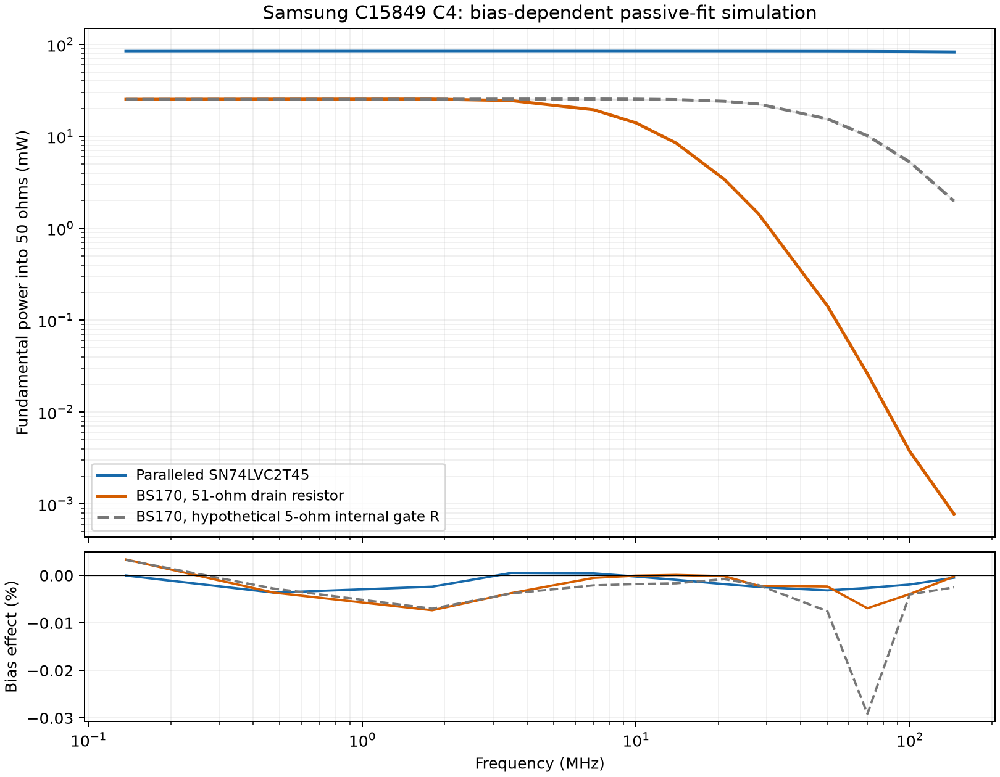

# SN74LVC2T45 versus BS170

This comparison uses Samsung CL10A105KB8NNNC / C15849 for C4, including its DC-bias dependence. At the band endpoints, the nominal paralleled SN74LVC2T45 model gives **84.32 mW at 137 kHz** and **83.03 mW at 145 MHz**. The resistor-fed BS170 gives **25.30 mW** and **0.0007803 mW**, respectively. These are exploratory simulations, not measured output ratings.

## Circuits and conditions

| Circuit | Configuration |
| --- | --- |
| SN74LVC2T45 | VCCA 3.3 V, VCCB 5 V, DIR high, tied A1/A2, and directly paralleled B1/B2 without output resistors; aligned nominal channels |
| Resistor-fed BS170 | Grounded source, direct clock-to-gate drive, no added gate bias or resistor, and a 51-ohm drain resistor to +5 V |
| Ideal-choke BS170 | Frequency-specific ideal drain choke; diagnostic cases excluded from quantitative conclusions because numerical robustness is poor |

All circuits run from a 5 V output supply with a raw 0–3.3 V clock, 50% duty cycle, 0.5 ns source transitions, and an illustrative 50-ohm source impedance. The output has 2 pF of PCB capacitance and feeds a resistive 50-ohm load through C4. The solver is ngspice at 25 C, using Gear integration and reltol 0.001. No external filter loss is included.

The logic model uses nominal IBIS output tables, transition weighting from the ramps, and simplified package effects. It is a behavioral surrogate, not a full IBIS or transistor-level simulation. It can double-count some capacitive transition effects. It does not fully represent internal crossover, supply-current transients, supply/ground bounce, process variation, thermal limits, channel skew, or current sharing. The flat logic response belongs to this model; it is not evidence of full-band board performance.

The input timing surrogate omits R1's explicit 10-kilohm loading. Ideal rails also leave out C1/C2/C3 and the supply/return network. There is no extracted PCB or connector model. See [model scope](MODEL-SCOPE.md) for how this relates to the selected parts.

The BS170 circuits include an illustrative 3 nH in both the gate and source leads. The Zetex model contains a 270-ohm internal gate resistor. A separate sensitivity case sets it to 5 ohms; that does not make it a verified model of another BS170. The ideal drain choke has 500 ohms reactance at each frequency, requiring about 581 uH at 137 kHz and 549 nH at 145 MHz. It has no loss, self-capacitance, or saturation, and it is not a single physical choke covering the whole band.

## C4 model

The [Samsung curves](https://weblib.samsungsem.com/mlcc/mlcc-ec.do?partNumber=CL10A105KB8NNN) give impedance magnitude and ESR at 25 C and 0, 2.5, and 5 V bias. Each has 300 samples between 100 Hz and 6 GHz. A project-generated passive Foster fit turns those graph exports into a transient circuit; it is not the manufacturer's nonlinear SPICE model. See the [standalone C4 analysis](C4-SELECTION.md).

The fit computes reactance magnitude as sqrt(max(0, impedance magnitude squared minus ESR squared)). It assigns a capacitive sign below the minimum-impedance sample and an inductive sign above it. The graphs contain no phase, so that sign choice has no independent phase check. The network uses nonnegative C/R/L and parallel-RC/RL coefficients, a minimum series resistance of 0.1 milliohm, and a 100-megohm leakage path.

| Source bias | Maximum magnitude error in 137 kHz–145 MHz | Maximum relative magnitude error | Maximum ESR error |
| --- | ---: | ---: | ---: |
| 0 V | 0.004415 ohms | 11.69% | 0.005406 ohms |
| 2.5 V | 0.004993 ohms | 12.26% | 0.006051 ohms |
| 5 V | 0.006805 ohms | 15.03% | 0.007955 ohms |

These errors are at the manufacturer's sample frequencies. Relative error looks large near resonance because the impedance itself is so small; it is not a bound on output-power error. Over the full 100 Hz–6 GHz fit range, the maximum relative magnitude errors match the table. RMS errors are about 2.35%, 2.61%, and 2.81%. Anything above 6 GHz is extrapolation.

Each circuit has a zero-bias control and a biased case. The biased case interpolates the common-basis coefficients at the initialized periodic output midpoint: about 2.515 V for the logic stage, 2.5–5 V for the resistor-fed BS170, and 5 V for the ideal-choke diagnostics. The interpolation stays within 0–5 V and keeps every element nonnegative. Points between the three source curves are an engineering approximation, not extra manufacturer data.

Within a transient run, C4 is linear at the chosen bias. Its capacitance does not change instantaneously with RF voltage, and the network omits hysteresis, aging, AC-amplitude dependence, and temperature/tolerance variation. In six checks on the logic and resistor-fed circuits, recentering the bias changes power by no more than 0.000579%.

## Results

Every row uses the biased Samsung fit. Power is the Fourier fundamental delivered to 50 ohms; harmonics and external filter losses are excluded. The chart's shading spans the zero-bias and biased results, not a confidence interval.

| Frequency | Paralleled SN74LVC2T45 | BS170 with 51-ohm drain resistor |
| --- | ---: | ---: |
| 0.137 MHz | 84.32 mW | 25.30 mW |
| 7 MHz | 84.48 mW | 19.50 mW |
| 14 MHz | 84.43 mW | 8.475 mW |
| 50 MHz | 84.22 mW | 0.1433 mW |
| 145 MHz | 83.03 mW | 0.0007803 mW |

Across the 78 accepted cases, DC bias changes power by at most 0.02911% from the matching zero-bias result. That includes the hypothetical 5-ohm internal-gate-resistance case, which gives about 1.981 mW at 145 MHz for the resistor-fed BS170. This is sensitivity to a model parameter, not a promise of achievable power.

The BS170 datasheet gives on-resistance with 10 V on the gate and gate-threshold voltage at a drain current of 1 mA. It offers no guarantee of low on-resistance or RF performance with 3.3 V gate drive, and it does not validate the Zetex model. There is no efficiency comparison because the logic surrogate lacks total supply-current modeling.

## Numerical checks and exclusions

The accepted set has 78 cases: thirteen frequencies, three circuit/model combinations, and two C4 bias conditions. Each successful run covers sixty periods. Fourier integration uses 32,001 uniformly resampled points from the final eight periods. Capacitor nodes start near the periodic DC midpoint; inductors start at zero current. This is not a model of transmitter keying.

A run passes base screening only if integration completes, peak load voltage stays below 30 V, mean load voltage stays below 50 mV, and power differs by less than 0.1% between the final two four-period windows. The accepted set has a maximum mean load voltage of 16.36 mV and a maximum late-window power change of 0.05454%. In fourteen representative checks, halving the maximum timestep changes power by at most 0.006521%. These tests check numerical consistency, not device accuracy.

The ideal-choke set has fifty successful diagnostic runs and two failed base cases at 70 MHz. One fails the stationarity test; the other produces an unphysical voltage. The broader checks also show a 3.53% timestep-dependent power change at 7 MHz, a 1.10% change at 10 MHz, and about a 24% change after bias recentering at 145 MHz. Other failures include an unphysical load excursion of about 203 V and a finer-step verification timeout. None of the ideal-choke results contribute to the quantitative comparison, and no gaps are filled by interpolation.

## Data and reproduction

- [Retained results: CSV](docs/simulation-samsung-results.csv) and [JSON](docs/simulation-samsung-results.json).
- [Verification, fit errors, and failures](docs/simulation-samsung-verification.json).
- [Successful diagnostic runs: CSV](docs/simulation-samsung-diagnostics.csv) and [JSON](docs/simulation-samsung-diagnostics.json).
- [Source and deck hashes](docs/comparison-samsung-manifest.json).
- [Simulation script](scripts/rerun_samsung_comparison.py), [verification script](scripts/verify_samsung_comparison.py), and [report script](scripts/report_samsung_comparison.py).

To run the study, the scripts need the local research workspace's simulate.py, manufacturer models, and practical-bs/ amplifier decks, plus numpy/scipy. Plotting also needs matplotlib. The simulation script takes --research, --source, and --output; the verification and report scripts take --project and --research. A base attempt has a 30-second limit and one finer-step retry. Additional checks allow forty seconds. Manufacturer sources stay local under their own terms.

The source material is the [Samsung product information](https://product.samsungsem.com/mlcc/CL10A105KB8NNN.do), [TI datasheet](https://www.ti.com/lit/ds/symlink/sn74lvc2t45.pdf), [TI IBIS model](https://www.ti.com/lit/ibs/SCEM409), and [onsemi BS170/MMBF170 datasheet](https://www.onsemi.com/pdf/datasheet/mmbf170-d.pdf). The local research workspace holds the Zetex model with its copyright notice. There are no assembled-board RF, thermal, or emissions measurements supporting these calculations.