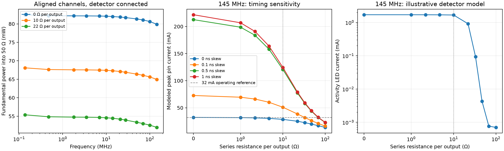

# Output sharing resistors

**10 ohms on each U1 output is the preferred power-preserving compromise in this study.** With the detector connected and aligned channels, it gives 68.1 mW at 137 kHz and 65.0 mW at 145 MHz into 50 ohms. It retains 81.3–82.6% of the direct-parallel model's nominal power across the 13-frequency sweep, a loss of about 0.90 dB. This choice gives roughly a 1 dB RF-power-loss budget priority over stronger isolation; it is not a unique optimum or a pulse-current guarantee.

At 145 MHz with an assumed 0.1 ns skew, 10 ohms lowers the larger modeled pin-current peak from 72.7 mA to 51.0 mA. Peak opposing current falls from 41.7 mA to 24.3 mA. The peak remains above [TI's 32 mA recommended output-current magnitude at a 5 V output supply](https://www.ti.com/lit/ds/symlink/sn74lvc2t45.pdf). That DC operating recommendation is not a specified pulse-current allowance. The model does not establish acceptable pulse operation or junction temperature.



## Candidate circuit

Each output has its own resistor, located between its U1 pin and the RF_RAW join. C4 and the R2 detector tap connect to the shared node. A resistor on the shared output cannot isolate the two pins from each other. The schematic and PCB have directly paralleled outputs; these resistors are simulation candidates and are absent from the design and BOM. The PCB's component pad nets match the schematic. The [current CAD checks](VALIDATION.md) describe the saved board. Geometry and copper-fill defects are outside this circuit model.

```text
U1.7 B1 ── RisoA ──┐
                   ├── RF_RAW ── C4 ── RF_OUT ── 50 Ω
U1.6 B2 ── RisoB ──┘      └──── R2 ── detector
```

Equal 10-ohm resistors appear as about 5 ohms of added source resistance to the common load while the outputs agree. Opposing output currents pass through both resistors. The resistors therefore trade output amplitude for isolation and sharing; their effect depends on switching time, device impedance, and load.

## Resistance sweep at 145 MHz

Nominal power and LED current use aligned channels. Current peaks use the skew shown in each column. They are the larger absolute current at either output pin. All cases retain Samsung C4, the 220-ohm R2, and the detector.

| Resistance on each output | Nominal fundamental power | Peak pin current, 0.1 ns skew | Peak pin current, 0.5 ns skew | Nominal activity LED |
| --- | ---: | ---: | ---: | ---: |
| 0 Ω | 79.89 mW | 72.7 mA | 212.7 mA | 1.718 mA |
| 1 Ω | 78.18 mW | 69.5 mA | 198.7 mA | 1.716 mA |
| 2.2 Ω | 76.19 mW | 66.1 mA | 183.8 mA | 1.713 mA |
| 4.7 Ω | 72.30 mW | 60.2 mA | 158.1 mA | 1.706 mA |
| 10 Ω | 64.96 mW | 51.0 mA | 120.6 mA | 1.686 mA |
| 22 Ω | 51.97 mW | 38.6 mA | 77.4 mA | 0.9204 mA |
| 33 Ω | 43.18 mW | 31.9 mA | 58.0 mA | 0.09427 mA |
| 47 Ω | 34.88 mW | 26.4 mA | 43.9 mA | 0.004298 mA |
| 68 Ω | 26.28 mW | 21.1 mA | 32.0 mA | 0.0007672 mA |
| 100 Ω | 18.22 mW | 16.2 mA | 22.7 mA | 0.000704 mA |

The 1–2.2 ohm values preserve power but provide little isolation. The 4.7-ohm option has a smaller power cost than 10 ohms and also a smaller current reduction. The 22- and 33-ohm options provide stronger isolation at a substantial RF-power cost, with much lower modeled LED current at 145 MHz. LED visibility depends on the actual selected parts and ambient light; the illustrative LED model does not rate brightness.

Larger skew remains a concern with 10 ohms: the model gives 120.6 mA at 0.5 ns and 124.4 mA at 1 ns. Those cases are stress diagnostics, not qualified operating points. Much larger resistors suppress those currents further, at the expense of RF output and detector drive. The chosen resistor value therefore needs a defined timing and current-margin target to support any guaranteed operating envelope. The assumed skew values are not TI specifications or measured probabilities.

## Frequency sweep

The direct-parallel reference is the aligned-channel detector-loaded [board circuit model](BOARD-SIMULATION.md). The 10- and 22-ohm candidates use 13 frequencies from 137 kHz through 145 MHz. The 10-ohm candidate also has the same full-band sweep at 0.1 ns skew. Fundamental power excludes external-filter and connector loss.

| Frequency (MHz) | Direct parallel (mW) | 10 Ω each (mW) | 22 Ω each (mW) | 10 Ω each: peak pin current at 0.1 ns skew (mA) |
| --- | ---: | ---: | ---: | ---: |
| 0.137 | 82.48 | 68.09 | 55.37 | 53.9 |
| 0.475 | 82.21 | 67.64 | 54.84 | 52.0 |
| 1.8 | 82.17 | 67.56 | 54.75 | 51.3 |
| 3.5 | 82.16 | 67.54 | 54.72 | 51.2 |
| 7 | 82.13 | 67.49 | 54.66 | 51.2 |
| 10 | 82.08 | 67.42 | 54.58 | 51.1 |
| 14 | 82.00 | 67.31 | 54.45 | 51.1 |
| 21 | 81.85 | 67.10 | 54.19 | 51.1 |
| 28 | 81.70 | 66.89 | 53.95 | 51.3 |
| 50 | 81.34 | 66.40 | 53.36 | 51.3 |
| 70 | 81.06 | 66.07 | 53.00 | 51.2 |
| 100 | 80.64 | 65.64 | 52.58 | 51.1 |
| 145 | 79.89 | 64.96 | 51.97 | 51.0 |

With 10 ohms and aligned channels, activity-LED current spans 1.69–1.79 mA. The full-band power response remains broad in this circuit model. Neither the source timing surrogate nor the flat response establishes compatibility with every Pico, Pi, or Si5351 configuration.

## Sharing between unequal outputs

The mismatch cases multiply channel 0's nominal drive tables by 1.10 and channel 1's by 0.90, with aligned timing. The added resistors use −1% on the stronger channel and +1% on the weaker channel. These are deliberately opposed hypothetical errors, not a manufacturer process corner. The RMS-current imbalance is the absolute difference divided by the mean of the two RMS currents. It measures sharing in these aligned-waveform cases, separately from timing-induced opposing current.

| Resistance on each output | Channel 0 RMS current | Channel 1 RMS current | RMS-current imbalance |
| --- | ---: | ---: | ---: |
| 0 Ω | 29.67 mA | 23.16 mA | 24.7% |
| 4.7 Ω | 27.27 mA | 22.88 mA | 17.5% |
| 10 Ω | 25.35 mA | 22.15 mA | 13.5% |
| 22 Ω | 22.20 mA | 20.23 mA | 9.3% |
| 33 Ω | 20.05 mA | 18.61 mA | 7.4% |

The series resistors reduce sensitivity to the assumed drive-strength difference. They do not force equal current during transitions or eliminate on-die switching loss.

Skew-driven pulses also occur at low frequency; their repetition rate changes the average loss. With 10 ohms and 1 ns skew, the larger resistor loss is 5.4 mW at 137 kHz and 40.7 mW at 145 MHz. This is resistor heating in the model, not U1 junction heating.

## Resistor loss and parasitics

At 145 MHz with aligned channels, each 10-ohm resistor dissipates about 5.6 mW. The largest modeled loss for either 10-ohm resistor among all cases is 40.7 mW. These are mean I-squared-R losses under the stated conditions, not a pulse-overload qualification. A chosen physical resistor also needs suitable continuous-power derating, pulse capability, and RF characteristics.

Separate 145 MHz, 0.1 ns-skew checks add an illustrative 0.5 nH in series and 0.05 pF across each resistor branch for 4.7, 10, and 22 ohms. They change power by at most 0.07% and peak pin current by 2.61%. These RLC values are sensitivity assumptions, not a selected component's model or a PCB extraction.

## Numerical checks and model limits

The [result record](docs/output-sharing-results.json) contains 92 cases, source-design and model hashes, and individual settling checks. The cases cover the 145 MHz resistance/skew screen, full-band candidate sweeps, low-frequency skew checks, drive-strength mismatch, resistor parasitics, and four finer-timestep checks. Ngspice uses Gear integration at 25 C, reltol 0.0001, and abstol 1e-12. Each case runs for 60 periods and measures the final eight. C4, C5, and C6 initial states are searched for final 20-period changes below 50 microvolts. A nearby completed case supplies a starting estimate where available; each accepted case independently meets the settling checks.

The maximum timestep is one period divided by 1400, or 2800 for the finer checks. Halving it changes power by at most 0.0024% and peak pin current by 0.020%. The late-window power check permits less than 0.1% change. These checks establish numerical consistency within the model.

U1 uses nominal IBIS-derived behavioral output tables with simplified timing and package effects. Transition weighting can double-count capacitive effects, so current spikes are especially uncertain. Complete internal crossover, supply-current transients, process corners, heating, and actual channel skew are absent. The diode and transistor models are Diodes Incorporated surrogates; the LED model is illustrative. They are not exact models of the selected Nexperia diode, CJ transistor, or KENTO LEDs.

The source is a raw 0–3.3 V clock with 50% duty cycle, 0.5 ns source transitions, and an illustrative 50-ohm source impedance. Supplies are ideal 3.3 V and 5 V rails. C4 uses the Samsung passive fit linearized near 2.515 V with periodic initial-charge adjustment. C1/C2/C3, supply wiring, real input-driver stages, extracted PCB traces and returns, SMA launches, and an external filter are absent. Power and current are simulated estimates; acceptable full-band operation and component temperatures remain unmeasured.
