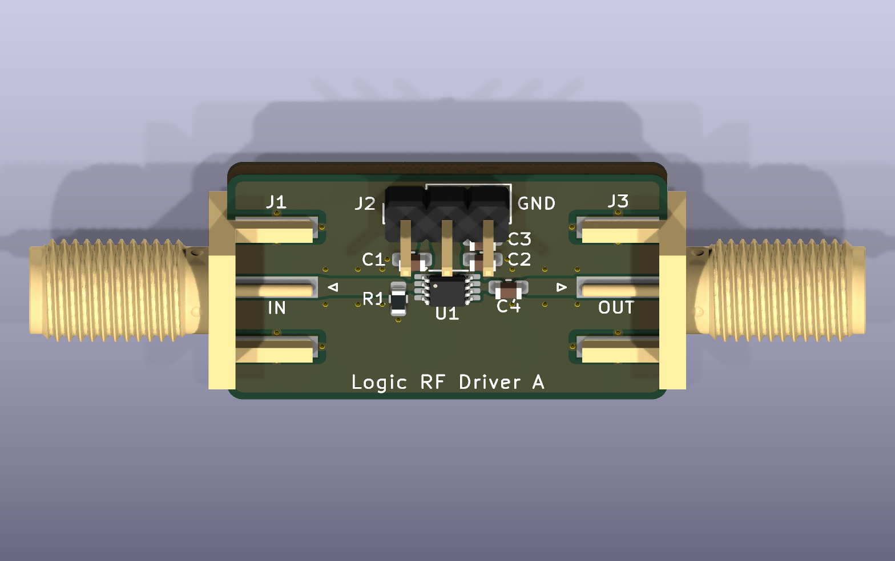

# Logic RF Driver

This two-layer board takes a raw 3.3 V CMOS clock and drives it through two paralleled SN74LVC2T45DCUR outputs powered from 5 V. Its target range is 137 kHz–145 MHz. Connect the output to a filter for the selected band, then to a 50-ohm load. The board has no RF power, thermal, emissions, or source-compatibility measurements.

Open [the KiCad project](Logic%20RF%20Driver.kicad_pro) for the schematic and PCB. The project includes the [symbols, footprints, and STEP models](libraries/README.md); their paths use `${KIPRJMOD}`.

## Connections

| Connector | Pin | Connection |
| --- | --- | --- |
| J1, CLOCK IN | Center | Raw 0–3.3 V CMOS clock from a Pico GPIO, Pi GPIO, or Si5351 CLK output |
| J1 | Shield | Ground |
| J2, POWER | 1 | +3.3 V for VCCA and DIR |
| J2 | 2 | +5 V for VCCB |
| J2 | 3 | Common ground |
| J3, RF TO LPF | Center | RF output through C4 to the selected-band filter and load |
| J3 | Shield | Ground |

Connect one clock source at a time, with a common ground for the source, supplies, board, filter, and load. J1 has no 50-ohm termination. The source must supply the desired frequency at valid logic levels; not every Pico, Pi, or Si5351 configuration can generate 145 MHz.

## Circuit

A1 and A2 share the clock input. B1 and B2 connect directly together, with no output resistors. DIR is tied to +3.3 V for A-to-B translation. R1 pulls the input low when it is undriven. C1 bypasses the 3.3 V supply, C2/C3 bypass the 5 V supply, and C4 blocks DC at the output.

The indicator samples `RF_RAW` on the U1 side of C4, through R2 (220 ohms) and C5 (10 nF). D1 is a BAT54S detector, Q1 is an MMBT3904, and D2 is the LED fed from +3.3 V through R4 (680 ohms). R3 is 1 Mohm, and C6 is 10 nF. C6 sits beside D1, with a 1.46 mm cathode connection and a nearby ground via. It stores rectified charge for Q1, while R3 provides a discharge path. The passive and LED footprints are 0603; D1 and Q1 use SOT-23. The detector loads U1's output stage. See the [input-loading study](INPUT-LOADING.md) for the R2 trade-off; its effect on RF output and total supply current is unmeasured and not included in the comparison model.

[TI's datasheet](https://www.ti.com/lit/ds/symlink/sn74lvc2t45.pdf) allows tying two outputs together for stronger drive. The device's electrical and thermal limits apply. Output current sharing and RF power across the target range are unmeasured on this board.

### Why the input is DC-coupled and C4 is on the output

The input needs a ground-referenced LOW and HIGH, so J1 is DC-coupled to A1/A2. R1 keeps it low if the clock source is disconnected or has high impedance. Putting a capacitor ahead of this pull-down removes the DC reference and can produce negative excursions or an unreliable HIGH. An AC-coupled clock or sine-wave source needs a separate bias and conditioning circuit.

The output capacitor has a different job: C4 removes the waveform's average voltage at the filter input. A 0–5 V waveform at 50% duty cycle has a nominal 2.5 V average, provided the downstream circuit gives it a DC return. The signal conductor is DC-blocked; the grounds are connected. See the [C4 impedance and bias analysis](C4-SELECTION.md).

## Parts and assembly

| References | Selected part | Specification | JLCPCB class |
| --- | --- | --- | --- |
| U1 | SN74LVC2T45DCUR / C15741 | VSSOP-8; dual-supply translator | Extended |
| R1 | 0603WAF1002T5E / C25804 | 10 kohms; 1%; 0.1 W; 0603 | Basic |
| R2 | 0603WAF2200T5E / C22962 | 220 ohms; 1%; 0.1 W; 0603 | Basic |
| R3 | 0603WAF1004T5E / C22935 | 1 Mohm; 1%; 0.1 W; 0603 | Basic |
| R4/R5 | 0603WAF6800T5E / C23228 | 680 ohms; 1%; 0.1 W; 0603 | Basic |
| C1/C2 | CC0603KRX7R9BB104 / C14663 | 100 nF; 10%; 50 V; X7R; 0603 | Basic |
| C3/C4 | CL10A105KB8NNNC / C15849 | 1 uF; 10%; 50 V; X5R; 0603 | Basic |
| C5/C6 | 0603B103K500NT / C57112 | 10 nF; 10%; 50 V; X7R; 0603 | Basic |
| D1 | BAT54S,215 / C47546 | 30 V; 200 mA; dual series Schottky; SOT-23 | Extended |
| D2/D3 | KT-0603R / C2286 | Red LED; 0603 | Basic |
| Q1 | MMBT3904(RANGE:100-300) / C20526 | NPN; 40 V; 200 mA; SOT-23 | Basic |

The sixteen-component [BOM](BOM.csv) covers U1, Q1, R1-R5, C1-C6, and D1-D3. Every assembly position has a selected ordering code in the hidden `LCSC Part #` field. The saved **JLCPCB** BOM preset exports the assembly columns and groups matching parts; see the [BOM export instructions](LCSC-PARTS.md#jlcpcb-bom-export). D2 indicates driver-output activity, and D3 indicates the 3.3 V supply through its own R5. J1/J2/J3 are visible in the schematic, board, and rendering, but excluded from the BOM and not marked DNP. J1/J3 use the Adafruit 1865 edge-launch SMA footprint. J2 has a shared footprint for an Adafruit 2136 three-position screw terminal or a straight 1×3 pin header, with 2.54 mm pitch, 1.2 mm holes, and 2.0 mm pads. The screw terminal is the default assembly option. Its body overhangs the board edge by 1.25 mm. The footprint silkscreen ends inside the board edge, while the fab outline and courtyard show the full housing. C1–C3 lie outside its courtyard. See [ordering codes and supplier information](LCSC-PARTS.md) and the [connector and assembly notes](CONNECTORS.md).

## Layout and checks

The board is 27.08 × 16.00 mm, with 1 mm corner radii and a nominal thickness of 1.57 mm. It has two copper layers, 83 front-layer track segments and 41 ground vias. Both layers have a filled ground zone, and stitching runs along both sides of the short RF paths. The placement grid is 0.25 mm, though several component anchors sit off it. See [layout details](PCB-LAYOUT.md).

The configured CAD checks report zero ERC violations, zero unconnected items, and zero schematic-parity issues. The saved PCB has filled ground zones and reports zero DRC violations, zero unconnected items, and zero schematic-parity issues. A local edge-contact rule covers the J1/J3 SMA lands, and all other copper retains the 0.50 mm edge setback. All connections are routed. Connector fit and RF performance remain unmeasured. All PCB DRC and schematic ERC categories are enabled. [Validation](VALIDATION.md) describes the warning checks.

## Project text variables

The PCB Editor exposes these settings under **File → Board Setup → Text & Graphics → Text Variables**. Schematic Setup also includes these definitions. The project file holds 16 variables for title blocks, headings, supply notes, and board labels; they are not machine-wide environment variables.

Edit the project file externally with the KiCad editors and the project closed. KiCad keeps settings in memory and can overwrite an external edit when it closes. Reopen the project to load the file, and check label fit and DRC for the resulting labels. See the [KiCad text-variable reference](https://docs.kicad.org/10.0/en/pcbnew/pcbnew.html#text_variables).

## Research and limitations

The [30 m transmitter/filter study](30M-TRANSMITTER.md) connects the board’s behavioral circuit model directly to the five-element L-first filter and the original seven-element C-first filter at 10.1401 MHz. The nominal L-first case predicts 65.5 mW into 50 ohms and a third harmonic near −76 dBc. Coil Q and line-length sensitivities and finer-timestep checks are included. The C-first comparison demands substantially higher modeled output current. Neither case establishes physical performance, safe current, or emissions compliance.

The [single-chip THS3491 amplifier study](THS3491-STUDY.md) evaluates a separate gain-of-five PA driven by this board, with input and output low-pass filters, supply current, and thermal estimates. Its nominal half-voltage divider predicts about 231–247 mW at the filtered load; the higher-drive divider predicts about 331–356 mW. It does not establish 500 mW across the full range. The PA is absent from the schematic, PCB, and BOM.

The [dual-chip THS3491 study](THS3491-DUAL-STUDY.md) evaluates TI's parallel RGT load-sharing core with inductor-first filters. It predicts about 335–357 mW at the filtered load with the 0.6 divider, compared with 330–344 mW from the matched single-RGT control. Each chip dissipates about 0.92 W, while total IC heat is about 1.84 W. Higher modeled output at 145 MHz requires a pin swing above TI's recommended linear envelope; the study does not establish 500 mW across the full range.

The [25-to-50-ohm THS3491 matching-filter study](THS3491-MATCHING-STUDY.md) evaluates a single RGT amplifier with an inductor-first matching/output filter. It predicts approximately 500 mW at nominal drive and about 600 mW with adjustment headroom. Filter tolerances and losses limit fixed-drive output, and approximately 2 W of IC heat requires a suitable PA thermal layout. It establishes nominal electrical feasibility, with continuous-duty reliability unqualified.

The [dual-chip THS3491 matching-filter study](THS3491-DUAL-MATCHING-STUDY.md) compares two RGT amplifiers with the same 25-to-50-ohm filters, source, losses, and tolerance cases. The 0.50 divider predicts 536–547 mW, with up to 1.32 W of heat per chip and 2.64 W total. The 0.55 divider gives nominal adjustment headroom at 645–662 mW and keeps the selected ±5% output-filter tolerance cases above 500 mW. Combined poorer-Q, higher-loss, and tolerance cases fall below 500 mW, and actual cooling and RF performance remain unqualified. The PA is absent from this project's CAD and BOM.

The [output-sharing resistor study](OUTPUT-SHARING.md) evaluates independent resistors on B1/B2. TI permits directly paralleling the two outputs, which is the design baseline. For optional resistive isolation, 10 ohms per output gives about 65–68 mW into 50 ohms in the model. Hypothetical skew tests do not demonstrate a need for these resistors. These resistors are absent from the schematic, PCB, and BOM.

The [board circuit simulation](BOARD-SIMULATION.md) includes the RF_RAW detector and both LED branches. Its nominal model predicts about 82.5 mW at 137 kHz and 79.9 mW at 145 MHz into 50 ohms, excluding filter and connector loss. Assumed-skew stress cases explore model sensitivity; their current peaks are not validated predictions of this IC or evidence of a timing fault. The study has no extracted PCB or supply-network model and does not establish thermal or full-band reliability.

The [SN74LVC2T45 versus BS170 comparison](COMPARISON.md) predicts about 84.32 mW at 137 kHz and 83.03 mW at 145 MHz for the paralleled logic stage, excluding filter loss. It uses a behavioral logic model, ideal supplies, and a bias-dependent C4 fit. These figures are simulated, not measured, and exclude the detector branch. The separate [detector study](INPUT-LOADING.md) gives about 82.48 mW at 137 kHz and 79.89 mW at 145 MHz with R2 at 220 ohms, using surrogate semiconductor and LED models. The ideal-choke BS170 results are diagnostic only because they fail numerical robustness checks. See [model scope](MODEL-SCOPE.md).

Project-owned work follows the repository [MIT license](../LICENSE.md). Library assets retain the [KiCad library license and exception](libraries/KICAD-LIBRARY-LICENSE.md). Manufacturer data retain their own terms.
