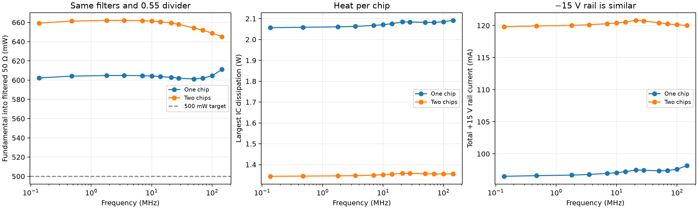

# Dual THS3491 with 25-to-50-ohm matching filters

Two THS3491RGT amplifiers in TI's parallel load-sharing arrangement predict 535.5–547.2 mW at the filtered 50-ohm load across thirteen test frequencies from 137 kHz to 145 MHz with the 0.50 divider. The same divider and filters give approximately 500 mW with one chip. The pair reduces heat and output current per chip, while increasing total supply draw and total heat. It improves nominal 500 mW operating margin, but does not guarantee 500 mW under all tested loss and tolerance conditions.



## Circuit and comparison

The circuit uses the parallel core in TI's [THS3491 datasheet](https://www.ti.com/lit/ds/symlink/ths3491.pdf), Figure 10-2, and [TIDA-060002 guide](https://www.ti.com/lit/ug/tidue75/tidue75.pdf). Each RGT has its own 24.9-ohm input resistor, 576-ohm feedback resistor, 143-ohm gain resistor, and 2.49-ohm output resistor. Feedback is local to each chip. The resistors join at the shared output; the amplifier pins are not directly tied together. Both devices use ideal ±15 V supplies and enabled PD inputs.

```text
                                           THS3491RGT A → 2.49 Ω ─┐
Logic RF Driver → input LPF → divider ──────┤                      ├→ COUT → matching/output LPF → 50 Ω
                                           THS3491RGT B → 2.49 Ω ─┘
```

The Logic RF Driver source, Samsung C4, detector, LEDs, divider ratios, input LPF, output coupling capacitor, and all seven output-network component values are identical to the [single-chip matching study](THS3491-MATCHING-STUDY.md). Each test frequency has its own synthesized L-C-L-C-L-C-L network. Its ideal input impedance is 25 + j0 ohms at that fundamental with a grounded 50-ohm load. There is no 25-ohm shunt load and no output transformer. This is a separate candidate PA; it is absent from the project schematic, PCB, and BOM.

Nominal inductors have Q = 50, capacitor Q is 1000, capacitor ESL is 0.3 nH, and winding capacitance is limited as in the single-chip study. Each filter has an additional matched 0.5 dB loss pad. The pads add to component loss. Endpoint cases use 0 or 1 dB extra loss per filter, Q = 25 or 100, and the same ±5% output L/C corner vectors as the single-chip comparison. All filters are inductor-first. These are synthesized values and illustrative losses, not selected or measured filter parts.

The second output branch reduces effective isolation resistance from 2.49 to 1.245 ohms and shares load current. That explains the modest RF power increase with the same drive. Parallel operation does not double output voltage or remove TI's high-frequency voltage-swing limit. The extra input and feedback network also contribute load and dissipation.

## Nominal RF power

| Divider voltage ratio | Single-chip load power (mW) | Dual-chip load power (mW) | Largest dual pin swing (Vpp) | Largest dual heat per chip (W) | Largest total dual heat (W) |
| --- | ---: | ---: | ---: | ---: | ---: |
| 0.5 | 497.2–506.2 | 535.5–547.2 | 12.07 | 1.32 | 2.64 |
| 0.55 | 601.2–611.1 | 645.2–662.1 | 13.27 | 1.36 | 2.72 |
| 0.6 | 714.8–725.3 | 764.1–787.9 | 14.48 | 1.39 | 2.78 |

The following table compares identical 0.50 dividers. Single/dual columns refer to complete PA stages. The dual stage delivers somewhat more RF power, so this is a same-drive comparison, not an exactly equal-output-power comparison. Small downward drive adjustment sets a nominal 500 mW point; the table retains the actual simulated settings.

| Frequency (MHz) | Single / dual load power (mW) | Single / dual total +15 V current (mA) | Single / dual total IC heat (W) | Largest dual heat per chip (W) | Largest dual external peak current per chip (mA) |
| --- | ---: | ---: | ---: | ---: | ---: |
| 0.137 | 497.7 / 544.8 | 89.2 / 112.0 | 1.98 / 2.61 | 1.31 | 114.8 |
| 0.475 | 499.3 / 546.6 | 89.3 / 112.1 | 1.99 / 2.61 | 1.31 | 115.0 |
| 1.8 | 499.8 / 547.2 | 89.4 / 112.2 | 1.99 / 2.61 | 1.31 | 115.1 |
| 3.5 | 499.9 / 547.2 | 89.5 / 112.3 | 1.99 / 2.62 | 1.31 | 115.2 |
| 7 | 499.7 / 547.0 | 89.7 / 112.4 | 1.99 / 2.62 | 1.31 | 115.4 |
| 10 | 499.4 / 546.8 | 89.8 / 112.5 | 2.00 / 2.62 | 1.31 | 115.6 |
| 14 | 499.0 / 546.3 | 89.9 / 112.7 | 2.00 / 2.63 | 1.31 | 115.8 |
| 21 | 498.3 / 545.4 | 90.2 / 112.9 | 2.01 / 2.64 | 1.32 | 116.2 |
| 28 | 497.8 / 544.3 | 90.1 / 112.8 | 2.01 / 2.64 | 1.32 | 116.1 |
| 50 | 497.2 / 541.5 | 90.1 / 112.6 | 2.01 / 2.63 | 1.32 | 115.7 |
| 70 | 498.2 / 540.0 | 90.1 / 112.5 | 2.01 / 2.63 | 1.32 | 115.5 |
| 100 | 500.4 / 538.0 | 90.3 / 112.4 | 2.01 / 2.63 | 1.32 | 115.4 |
| 145 | 506.2 / 535.5 | 90.8 / 112.3 | 2.02 / 2.63 | 1.32 | 115.2 |

The negative-rail current is approximately the same magnitude as the positive-rail current. Individual chip currents, separate rail measurements, RMS output currents, source loading, and detector/LED draw are in the [result record](docs/ths3491-dual-matching-results.json). Current figures are estimates from the models; they do not qualify the Logic RF Driver or a particular clock source.

## External RF losses

RF leaving the amplifiers includes energy dissipated in the branch resistors, coupling capacitor, matching network, and output pad. The table separates these external losses from IC heat. COUT ESR adds approximately 1 mW or less at these nominal settings.

| Frequency (MHz) | Divider ratio | Total real external PA output (mW) | Both branch resistors (mW) | Output filter and pad (mW) | Fundamental load power (mW) |
| --- | ---: | ---: | ---: | ---: | ---: |
| 0.137 | 0.5 | 697.2 | 32.7 | 118.8 | 544.8 |
| 145 | 0.5 | 686.7 | 33.0 | 117.3 | 535.5 |
| 0.137 | 0.55 | 843.6 | 39.6 | 143.8 | 659.3 |
| 145 | 0.55 | 827.3 | 39.8 | 141.3 | 645.2 |

## Loss and tolerance margin

The independent passive-network check evaluates all 128 sign combinations of ±5% output L/C tolerance at each endpoint. Its selected low-power, high-power, and high-current vectors are identical to those in the single-chip study. The complete transient cases replay those corners with the source and PA. This is an endpoint corner exercise, not a statistical yield prediction or a continuous sweep of a practical filter bank.

| Frequency (MHz) | Divider ratio | Sensitivity | Single / dual load power (mW) | Largest dual pin swing (Vpp) | Largest dual heat per chip (W) |
| --- | ---: | --- | ---: | ---: | ---: |
| 145 | 0.55 | ±5% output L/C corner | 497.1 / 516.6 | 13.02 | 1.19 |
| 145 | 0.55 | ±5% output L/C corner | 740.3 / 797.2 | 13.08 | 1.56 |
| 145 | 0.55 | 1 dB extra loss/filter, Q = 25, ±5% output L/C corner | 352.4 / 367.0 | 12.09 | 1.17 |
| 145 | 0.5 | Q = 100 | 539.5 / 570.8 | 12.00 | 1.32 |
| 145 | 0.5 | Q = 25 | 445.4 / 471.1 | 11.67 | 1.30 |
| 145 | 0.5 | ±5% output L/C corner | 411.7 / 428.8 | 11.87 | 1.16 |
| 145 | 0.5 | ±5% output L/C corner | 613.2 / 661.7 | 11.92 | 1.51 |
| 145 | 0.5 | 0 dB extra loss/filter | 636.3 / 672.2 | 12.58 | 1.34 |
| 145 | 0.5 | 1 dB extra loss/filter | 402.6 / 426.5 | 11.24 | 1.29 |
| 145 | 0.6 | 1 dB extra loss/filter, Q = 25, ±5% output L/C corner | 418.4 / 435.0 | 13.16 | 1.19 |
| 0.137 | 0.55 | ±5% output L/C corner | 492.0 / 528.4 | 13.25 | 1.18 |
| 0.137 | 0.55 | ±5% output L/C corner | 721.4 / 807.2 | 13.25 | 1.54 |
| 0.137 | 0.55 | 1 dB extra loss/filter, Q = 25, ±5% output L/C corner | 351.8 / 378.0 | 12.27 | 1.16 |
| 0.137 | 0.5 | Q = 100 | 529.2 / 579.5 | 12.16 | 1.31 |
| 0.137 | 0.5 | Q = 25 | 440.0 / 481.2 | 11.82 | 1.29 |
| 0.137 | 0.5 | ±5% output L/C corner | 406.6 / 436.7 | 12.05 | 1.15 |
| 0.137 | 0.5 | ±5% output L/C corner | 596.9 / 668.0 | 12.05 | 1.49 |
| 0.137 | 0.5 | ±5% output L/C corner | 596.1 / 667.1 | 12.05 | 1.49 |
| 0.137 | 0.5 | 0 dB extra loss/filter | 626.6 / 685.9 | 12.76 | 1.33 |
| 0.137 | 0.5 | 1 dB extra loss/filter | 395.4 / 432.8 | 11.37 | 1.28 |
| 0.137 | 0.6 | 1 dB extra loss/filter, Q = 25, ±5% output L/C corner | 418.7 / 449.9 | 13.39 | 1.19 |

The pair improves current sharing and cooling per chip. It does not restore voltage lost in the filters or compensate for source-amplitude variation. The combined low-power tolerance, Q = 25, and 1 dB-per-filter loss cases remain below 500 mW with the highest tested divider ratio. A guaranteed fixed-drive 500 mW output is therefore not established.

Band-specific adjustment or power regulation can address some variation, but the required drive and output swing must remain within TI's linear region at 145 MHz. Input-filter tolerances, actual component self-resonance and saturation, source/process/temperature spread, PCB stability, and mismatched loads remain unqualified. The model's low harmonics do not establish measured spectral purity.

## Offset and current sharing

The offset sensitivity uses additional opposing ±22.5 mV output-referred offsets, imposed at the two inputs through the closed-loop gain. This is the same stated offset scale as the load-sharing study. The nominal macro-model offsets remain present.

| Frequency (MHz) | Load power (mW) | Modeled opposing-current peak (mA) | Largest IC heat (W) | Total IC heat (W) |
| --- | ---: | ---: | ---: | ---: |
| 145 | 645.2 | 9.02 | 1.36 | 2.72 |
| 0.137 | 659.3 | 8.94 | 1.35 | 2.69 |

The two nominal models share current closely because their signal paths are identical. The offset cases test one source of circulating current; they do not bound real AC gain or phase mismatch. The 2.49-ohm resistors provide finite isolation. A near-zero signed-average RF current is not proof of device lifetime.

## Supply and thermal requirements

At the 0.55 divider, PA-only DC power is 3.59–3.62 W, and total IC heat reaches 2.72 W. The largest nominal per-chip dissipation is 1.36 W. An assumed 85%-efficient converter draws approximately 846–853 mA from 5 V for the PA rails alone. Add the Logic RF Driver's 5 V and 3.3 V loads. Internal logic switching/crossover power and actual converter behavior remain outside the current model.

TI's RGT reference-board junction-to-ambient value of 49.6 °C/W gives approximately 92 °C junction temperature at 25 °C ambient and 117 °C at 50 °C ambient, ignoring heat from the other chip. An illustrative 10 °C/W mutual thermal coupling adds approximately 14 °C, giving about 131 °C at the higher ambient. These are separate thermal-resistance calculations, not simulated temperatures or a qualified two-chip layout.

TI lists 125 °C for continuous-operation, long-term junction reliability and 150 °C absolute maximum. The two-chip arrangement offers substantially better per-chip cooling margin than one device, but copper, exposed-pad soldering, thermal vias, chip spacing, and any heatsink must support the combined heat. Thermal coupling can consume that margin.

TI also lists ±100 mA continuous output current with an electromigration footnote, separately from its typical ±420 mA linear-drive capability. The interpretation for this RF waveform remains unresolved here. Splitting the load reduces peak and RMS current per chip, but the headline drive capability and a nominal model are not a lifetime guarantee. TI's output-voltage envelope still applies to each device.

## Validation and reproduction

The study contains 66 transient cases and 256 passive-network tolerance corners. Four cases halve the maximum timestep; RF power changes by at most 0.00464%, and total IC heat by at most 0.001826%. Independent passive-network power transfer agrees within 0.004553%, and independent half-wave output-plus-feedback current accounting agrees with the rail measurements within 0.0002667 mA. The largest output-path power-balance discrepancy is 8.44 µW.

Each transient uses 60 periods, measures the final eight, and checks source capacitor-state drift below 50 µV and successive four-period power drift below 0.1%. The electrical models remain at 25 °C with ideal supplies. They do not include electrothermal feedback, extracted PCB parasitics, all device corners, or real filter parts. The documented negative-rail current-source sign correction and RGT package-model limitations are the same as in the single-chip study; signal-path model elements retain the vendor values.

Run `scripts/check_ths3491_dual_matching_network.py`, `scripts/simulate_ths3491_dual_matching.py`, and `scripts/report_ths3491_dual_matching.py` with the same `--research` and output arguments as the single-chip matching study. The runner requires `--board-runs` and uses the single-chip matching raw-run directory for `--single-runs` initial-state estimates. TI's unmodified RGT model is required under the output directory's `models/` folder. Generated decks, C4 fits, raw waveforms, and vendor models remain in ignored storage. Source and model hashes identify the retained inputs.

**The pair improves nominal 500 mW current and thermal margin; full-band reliability remains unqualified.** No KiCad source or BOM is changed, and no hardware performance is claimed.
