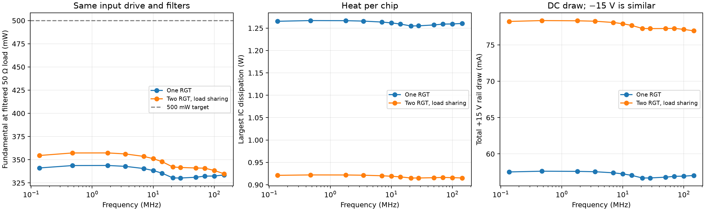

# Dual THS3491 load-sharing study

Two THS3491RGT devices in TI's parallel load-sharing arrangement predict 335–357 mW at the filtered 50-ohm load across 137 kHz–145 MHz with the 0.6 input divider. The matched single-RGT control predicts 330–344 mW. The pair shares output current and reduces dissipation per chip; it does not double RF output with this voltage gain, input drive, and load.



## TI circuit and scope

TI's [TIDA-060002 reference design](https://www.ti.com/tool/TIDA-060002) demonstrates two or more THS3491RGT amplifiers sharing a low-resistance or capacitive load. Its [design guide](https://www.ti.com/lit/ug/tidue75/tidue75.pdf) provides the dual circuit in Figure 20 and output resistor values in Table 3. The THS3491 [datasheet](https://www.ti.com/lit/ds/symlink/ths3491.pdf) also shows two gain-of-five channels with 24.9-ohm input resistors and separate 2.49-ohm output resistors in Figure 10-2.

The nominal model uses that parallel core: both noninverting inputs receive the same signal through individual 24.9-ohm resistors. Each RGT device has its own feedback resistor of 576 ohms from FB to the inverting input, and 143 ohms from that input to ground. Each output feeds a 2.49-ohm resistor; the two resistors join at the shared output. Feedback is local to each amplifier, upstream of its output resistor. Both chips use ideal ±15 V supplies and enabled PD inputs. The single-RGT control has the same gain, input resistor, and 2.49-ohm output resistor.

```text
                                      THS3491RGT A ── 2.49 Ω ──┐
Logic RF Driver ── input LPF ── divider ──┤                     ├── COUT ── output LPF ── 50 Ω
                                      THS3491RGT B ── 2.49 Ω ──┘
```

This is TI's load-sharing core adapted to the Logic RF Driver and its band-selected filters. It is not an exact model of the complete TIDA board. The modeled input uses the representative band-selected filters described here; TI's board uses a fixed 150-MHz Bessel filter. The output network variants use TI's published resistor values with this same filter chain, not TI's full measurement fixture. No amplifier outputs are directly shorted together, and no capacitor-first filters are used.

## Source, filters, and models

The source is the detector-loaded Logic RF Driver circuit from the [single-chip study](THS3491-STUDY.md), including Samsung C4 and both LEDs. Input and output filters are fifth-order inductor-first Butterworth ladders designed for 50-ohm terminations. Each test frequency uses its own scaled component values, with cutoff at 1.5 times that frequency. The nominal inductor Q is 50, capacitor Q is 1000, capacitor ESL is 0.3 nH, and winding capacitance is limited to 2 pF as in the single-chip study. An extra matched loss network adds 0.5 dB at each filter; endpoint cases use 0 or 1 dB. These are representative networks, not selected or measured filter parts.

The divider presents a nominal 50-ohm input. The 0.6 ratio uses 125 ohms to ground at its input, 33.333 ohms in series, and 50 ohms to ground at the amplifier-input node. The 0.5 ratio uses 100, 50, and 50 ohms. A 0.75 ratio is a higher-drive sensitivity with the corresponding matched divider values. The output coupling capacitor is 1 µF with illustrative 0.03-ohm ESR and 0.5 nH ESL.

The simulation uses TI's [RGT model](https://www.ti.com/lit/zip/SBOMAN4), with its separate FB and OUT pins connected as specified. It joins these pins internally through 1 microohm; it is not a complete model of package trace resistance. The model's negative-rail load-current source has the same sign issue described in the single-chip study. Only that source's sign is corrected. Independent half-wave output-current accounting agrees with the corrected rail currents within 0.00020671 mA. Signal-path elements remain unchanged.

## Full-band comparison

Both configurations use the 0.6 divider, nominal filters, and the same RGT model. Rail currents are the total for the entire PA, not per chip. The RGT control separates load sharing from the package and feedback-value differences relative to the DDA circuit.

| Frequency (MHz) | One RGT load power (mW) | Two RGT load power (mW) | Largest dual pin swing (Vpp) | Dual +15 V / −15 V draw (mA) | Largest dual IC heat (W) | Total dual IC heat (W) |
| --- | ---: | ---: | ---: | ---: | ---: | ---: |
| 0.137 | 341.1 | 354.5 | 14.46 | 78.2 / 78.2 | 0.92 | 1.84 |
| 0.475 | 343.7 | 357.3 | 14.48 | 78.4 / 78.4 | 0.92 | 1.84 |
| 1.8 | 343.8 | 357.3 | 14.48 | 78.3 / 78.5 | 0.92 | 1.84 |
| 3.5 | 342.8 | 356.2 | 14.47 | 78.3 / 78.3 | 0.92 | 1.84 |
| 7 | 340.5 | 353.6 | 14.45 | 78.1 / 78.1 | 0.92 | 1.84 |
| 10 | 338.3 | 351.1 | 14.43 | 77.9 / 77.9 | 0.92 | 1.84 |
| 14 | 335.4 | 347.9 | 14.40 | 77.7 / 77.7 | 0.92 | 1.84 |
| 21 | 330.4 | 342.1 | 14.34 | 77.3 / 77.3 | 0.92 | 1.83 |
| 28 | 330.3 | 341.6 | 14.33 | 77.2 / 77.2 | 0.92 | 1.83 |
| 50 | 331.0 | 341.1 | 14.30 | 77.3 / 77.2 | 0.92 | 1.83 |
| 70 | 332.3 | 340.9 | 14.28 | 77.3 / 77.3 | 0.92 | 1.83 |
| 100 | 332.4 | 338.4 | 14.23 | 77.1 / 77.1 | 0.92 | 1.83 |
| 145 | 333.5 | 334.8 | 14.15 | 76.9 / 76.9 | 0.92 | 1.83 |

With the 0.5 divider, the dual circuit predicts 235–248 mW. With identical nominal chips, each carries approximately half the external output current. This equal split is a model result, not a bound on actual device matching.

## Output networks, loss, and higher drive

The datasheet AWG output network uses 40.2 ohms per branch and 30 ohms between the join and the output. TIDA Table 3's total-RLOAD = 50-ohm row uses 40-ohm branch resistors, 5 ohms after the join, and a 50-ohm shunt load in addition to the external load. These networks trade output voltage for load isolation, matching, or a defined test load. TI's reference-guide 20-Vpp test level is referred to the amplifier outputs; it is not automatically the voltage at the external 50-ohm instrument. The datasheet front-page example labels 13 Vpp maximum at its matched 50-ohm load. A sinusoidal 13 Vpp there corresponds to 423 mW, excluding external filter loss; that label does not establish the same swing at 145 MHz. They are included without removing their resistor losses. Branch values of 1 and 10 ohms are explicit RF sensitivity cases, not declarations that TI qualifies those values for every filter and layout.

| Frequency (MHz) | Output network | Divider ratio | Extra loss per filter (dB) | Load power (mW) | Largest chip pin swing (Vpp) | Total IC heat (W) |
| --- | --- | ---: | ---: | ---: | ---: | ---: |
| 0.137 | 1 Ω branches | 0.6 | 0.5 | 363.2 | 14.46 | 1.85 |
| 0.137 | 10 Ω branches | 0.6 | 0.5 | 315.1 | 14.46 | 1.80 |
| 0.137 | 2.49 Ω branches | 0.6 | 0 | 446.3 | 15.32 | 1.86 |
| 0.137 | 2.49 Ω branches | 0.6 | 0.5 | 354.5 | 14.46 | 1.84 |
| 0.137 | 2.49 Ω branches | 0.6 | 1 | 281.6 | 13.65 | 1.82 |
| 0.137 | 2.49 Ω branches | 0.75 | 0.5 | 554.0 | 18.08 | 1.89 |
| 0.137 | Datasheet AWG output network | 0.6 | 0.5 | 109.8 | 14.46 | 1.53 |
| 0.137 | TIDA Table 3, total RLOAD = 50 Ω | 0.6 | 0.5 | 100.8 | 14.46 | 1.96 |
| 145 | 1 Ω branches | 0.6 | 0.5 | 343.1 | 14.15 | 1.84 |
| 145 | 10 Ω branches | 0.6 | 0.5 | 297.5 | 14.15 | 1.79 |
| 145 | 2.49 Ω branches | 0.6 | 0 | 419.7 | 14.96 | 1.85 |
| 145 | 2.49 Ω branches | 0.6 | 0.5 | 334.8 | 14.15 | 1.83 |
| 145 | 2.49 Ω branches | 0.6 | 1 | 267.0 | 13.39 | 1.81 |
| 145 | 2.49 Ω branches | 0.75 | 0.5 | 513.7 | 17.53 | 1.89 |
| 145 | Datasheet AWG output network | 0.6 | 0.5 | 103.5 | 14.12 | 1.52 |
| 145 | TIDA Table 3, total RLOAD = 50 Ω | 0.6 | 0.5 | 95.3 | 14.15 | 1.94 |

The 145 MHz, 0.75-divider case predicts 513.7 mW at the load, but requires 17.53 Vpp at each chip. TI's maximum recommended linear-output graph permits approximately 14–15 Vpp there on ±15 V supplies. A nominal model producing more RF power above that envelope does not establish acceptable linear operation.

The pair increases available output current. Both chips still produce essentially the same output voltage, so sharing does not multiply the permitted voltage swing or eliminate internal large-signal limitations. TI's demonstrated heavy-load results establish a useful topology; they do not establish this source/filter chain at 500 mW through 145 MHz. Different impedance matching or another PA arrangement can change that conclusion.

## Offset and current sharing

TI's design guide calculates a worst-case output-referred DC offset of ±22.5 mV for its stated gain, source resistance, input offset, and input-bias assumptions. The endpoint sensitivities impose equal and opposite additional input offsets scaled to that output level. The nominal model's own offset remains present. These cases are an explicit offset stress, not a full process or temperature corner and not a model of AC gain/phase mismatch.

| Frequency (MHz) | Load power (mW) | Modeled opposing-current peak (mA) | Mean external current A / B (mA) | Total IC heat (W) |
| --- | ---: | ---: | ---: | ---: |
| 0.137 | 354.5 | 8.97 | -9.02 / 9.03 | 1.85 |
| 145 | 334.8 | 9.02 | -9.02 / 9.02 | 1.84 |

The output resistors limit mismatch current. Identical nominal models with no imposed offset cannot establish actual current sharing. AC gain and phase mismatch remain unmodeled.

## Supply and thermal estimates

The dual PA draws 76.9–78.4 mA from +15 V and 76.9–78.5 mA from −15 V. Its electrical input is 2.31–2.35 W. With an assumed 85%-efficient converter, that is approximately 543–553 mA from a 5 V converter input for the PA alone. Add the Logic RF Driver's modeled 5 V pull-up current and its separate 3.3 V circuitry. The source-stage current and clock-load limitations in the single-chip study apply.

IC heat is supply input power minus real power leaving each chip through its output and feedback pins. Output-resistor, coupling-capacitor, and filter dissipation are external to the IC heat numbers. The two-chip circuit dissipates up to 0.92 W per chip and 1.84 W in the chips together at nominal drive. Each extra amplifier adds quiescent power, so lower per-chip dissipation does not imply lower total dissipation.

TI lists 49.6 °C/W junction-to-ambient for the RGT package on its reference test board. The table applies the largest nominal per-chip heat to Tj = Ta + Pd × thermal resistance. It assumes no mutual thermal coupling and is only a cooling sensitivity, not a prediction for a compact two-chip PCB.

| Assumed per-chip thermal resistance (°C/W) | Junction at 25 °C ambient (°C) | Junction at 50 °C ambient (°C) |
| --- | ---: | ---: |
| 40 | 62 | 87 |
| 49.6 | 71 | 96 |
| 60 | 80 | 105 |
| 80 | 99 | 124 |
| 100 | 117 | 142 |

At the 49.6 °C/W reference value, an illustrative mutual coupling of 10 °C/W adds approximately 9 °C from the other chip's heat. Actual pad soldering, thermal vias, copper area, chip spacing, and heatsinking determine the temperatures. The electrical models stay at 25 °C; neither self-heating nor temperature-dependent device response is simulated.

## Validation and reproduction

The [result record](docs/ths3491-dual-results.json) contains 58 cases, source/model hashes, individual chip currents and power, settling checks, and numerical comparisons. All cases use inductor-first input and output filters. Every transient runs 60 periods, measures the final eight, and checks the three source capacitor states for less than 50 µV change over the final 20 periods. Successive four-period power windows differ by less than 0.1%. Ngspice uses Gear integration, reltol 0.0001, and abstol 1e-12.

Three endpoint checks halve the maximum timestep. Output power changes by at most 0.002175%, and total IC heat changes by at most 0.0003707%. Numerical consistency does not validate the actual devices, filters, PCB stability, harmonic distortion, or thermal behavior. The models do not establish real AC mismatch, manufacturing corners, or output-filter mismatch tolerance.

Run `scripts/simulate_ths3491_dual.py` with `--research`, `--output`, `--board-runs`, and `--single-runs`, then run `scripts/report_ths3491_dual.py` with `--research` and `--runs`. The output directory needs TI's unmodified `THS3491RGT.lib` under `models/`; the report also expects the downloaded TI guide, schematic, and model archive. The retained source decks, C4 fits, retained periodic-state estimates, and external research helper are required as described in the single-chip study. Vendor model text and raw runs remain in ignored `generated/` storage.

The candidate PA is absent from the project schematic, PCB, and BOM. This study changes no CAD assets and makes no measured RF or thermal claim.
