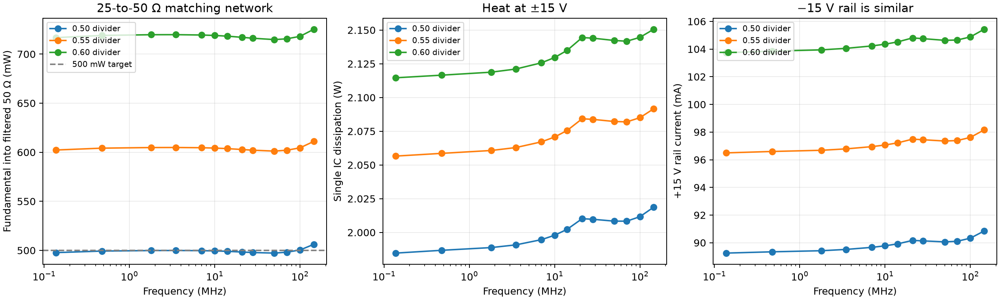

# THS3491 with 25-to-50-ohm matching filters

A single THS3491RGT with an inductor-first matching/output filter predicts approximately 500 mW at the 50-ohm load at the thirteen tested frequencies from 137 kHz to 145 MHz. The 0.50 divider predicts 497.2–506.2 mW. A 0.55 divider provides nominal adjustment headroom at 601.2–611.1 mW, with about 2.09 W of IC heat. Filter matching makes 500 mW electrically plausible; these results do not establish a reliable continuous-duty, full-band amplifier.



## Circuit and filter definition

The source is the Logic RF Driver circuit in the [single-chip study](THS3491-STUDY.md), including Samsung C4, the RF_RAW detector, and both LEDs. The PA uses TI's RGT macro-model, ±15 V ideal rails, gain-setting resistors of 576 and 143 ohms, a 24.9-ohm noninverting-input resistor, and a 2.49-ohm output isolation resistor. Feedback remains local to the amplifier, upstream of the isolation resistor. This candidate PA is absent from the KiCad schematic, PCB, and BOM.

```text
Logic RF Driver → input LPF → divider → THS3491RGT → 2.49 Ω → COUT → L-C-L-C-L-C-L → 50 Ω
```

The input is a fifth-order, 50-ohm, inductor-first Butterworth LPF with cutoff at 1.5 times the operating frequency. The output comprises an inductor-first L/C matching section and a fifth-order 50-ohm LPF with that same cutoff ratio. Its seven reactive elements are L-C-L-C-L-C-L. The matching section is synthesized against the complex input impedance of the complete lossless LPF, so the output network presents exactly 25 + j0 ohms at the selected fundamental with an ideal 50-ohm load. It contains no 25-ohm shunt termination and no output transformer.

Each test frequency uses a separate set of component values. This is a band-selected family of networks, not one fixed filter covering the entire frequency span. The matching applies at the operating frequency; the complete seven-element response is not a seventh-order Butterworth response. Its passband, harmonic rejection, and response across each actual operating band require evaluation with selected parts.

The table gives representative unrounded synthesis values in signal-path order. L values are in µH and C values in nF; these are calculation values, not an orderable parts list.

| Frequency (MHz) | L1 (µH) | C2 (nF) | L3 (µH) | C4 (nF) | L5 (µH) | C6 (nF) | L7 (µH) |
| --- | ---: | ---: | ---: | ---: | ---: | ---: | ---: |
| 0.137 | 35.068 | 19.402 | 23.933 | 25.063 | 77.448 | 25.063 | 23.933 |
| 145 | 0.033 | 0.018 | 0.023 | 0.024 | 0.073 | 0.024 | 0.023 |

Inductor Q is 50 at the test frequency; winding capacitance is limited to 2 pF or a value corresponding to a self-resonance at 7.5 times the operating frequency. Capacitor Q is 1000, with 0.3 nH series inductance. Each filter also has a matched 0.5 dB loss pad, representing additional unmodeled loss. The output pad is on the 50-ohm side. The extra pads add to component loss; 0.5 dB is not the total output-filter loss. COUT is 1 µF with 0.03-ohm ESR and 0.5 nH ESL. Filter capacitors have no intended DC bias; the source Samsung C4 retains its DC-biased fit.

## Nominal power and drive

The divider presents a nominal 50-ohm input. For voltage ratio a, its input shunt is 50/(1−a) ohms, series resistor is 50(1/a−1) ohms, and output shunt is 50 ohms. The 0.55 ratio uses approximately 111.11, 40.91, and 50 ohms, respectively. It is a drive setting, not closed-loop output-power regulation.

| Divider voltage ratio | Filtered load power over thirteen frequencies (mW) | Largest pin swing (Vpp) | Largest IC heat (W) |
| --- | ---: | ---: | ---: |
| 0.5 | 497.2–506.2 | 12.12 | 2.02 |
| 0.55 | 601.2–611.1 | 13.31 | 2.09 |
| 0.6 | 714.8–725.3 | 14.50 | 2.15 |

The following table uses the 0.55 divider. Power is the fundamental delivered to the external 50-ohm load. Rail currents refer to the PA alone. The current peak is the external output current; the amplifier also supplies its feedback network.

| Frequency (MHz) | Load power (mW) | Amplifier pin swing (Vpp) | Output peak current (mA) | +15 V / −15 V current (mA) | IC heat (W) |
| --- | ---: | ---: | ---: | ---: | ---: |
| 0.137 | 602.3 | 13.26 | 241.4 | 96.5 / 96.5 | 2.06 |
| 0.475 | 604.2 | 13.28 | 241.8 | 96.6 / 96.7 | 2.06 |
| 1.8 | 604.8 | 13.28 | 242.1 | 96.7 / 96.8 | 2.06 |
| 3.5 | 604.8 | 13.28 | 242.3 | 96.8 / 96.9 | 2.06 |
| 7 | 604.6 | 13.26 | 242.7 | 96.9 / 97.0 | 2.07 |
| 10 | 604.2 | 13.24 | 243.0 | 97.1 / 97.1 | 2.07 |
| 14 | 603.7 | 13.22 | 243.5 | 97.2 / 97.2 | 2.08 |
| 21 | 602.8 | 13.17 | 244.3 | 97.5 / 97.5 | 2.08 |
| 28 | 602.1 | 13.17 | 244.2 | 97.4 / 97.4 | 2.08 |
| 50 | 601.2 | 13.18 | 243.8 | 97.4 / 97.3 | 2.08 |
| 70 | 602.1 | 13.21 | 243.9 | 97.4 / 97.4 | 2.08 |
| 100 | 604.5 | 13.24 | 244.6 | 97.6 / 97.6 | 2.09 |
| 145 | 611.1 | 13.31 | 246.2 | 98.2 / 98.1 | 2.09 |

The gain-of-five source chain has adequate nominal drive for the approximately 500 mW operating point. It uses the source's modeled voltage into its actual input filter and divider, rather than assuming that 80 mW is available unchanged at the PA input. These calculations do not establish source compatibility or power for every Pico, Pi, or Si5351 configuration.

## Loss and tolerance sensitivity

This nominal loss breakdown separates RF leaving the amplifier from resistor and filter dissipation. COUT adds less than 1 mW of ESR loss at these operating points. The filter-loss column includes finite-Q component loss and the extra output pad. IC heat is separate from all these external losses.

| Frequency (MHz) | Divider ratio | Real external PA output (mW) | 2.49 Ω loss (mW) | Output filter and pad loss (mW) | Fundamental load power (mW) | Output filter/pad loss (dB) |
| --- | ---: | ---: | ---: | ---: | ---: | ---: |
| 0.137 | 0.5 | 666.8 | 59.8 | 108.6 | 497.7 | 0.86 |
| 145 | 0.5 | 680.3 | 62.5 | 110.9 | 506.2 | 0.86 |
| 0.137 | 0.55 | 806.8 | 72.4 | 131.3 | 602.3 | 0.86 |
| 145 | 0.55 | 821.2 | 75.4 | 133.8 | 611.1 | 0.86 |

Endpoint loss cases use 0 or 1 dB extra matched loss per filter. Q cases use 25 or 100 in both filters. The independent complex-impedance check evaluates all 128 sign combinations of ±5% output-network L/C tolerances at each endpoint, with the nominal finite-Q and parasitic assumptions. It verifies the ideal 25 + j0-ohm match and selects low-power, high-power, and high-current corners for complete source-plus-PA transient replay. This is a deterministic corner exercise, not a statistical production-yield prediction.

The output-network input resistance spans approximately 20–32 ohms in these corner checks. A fixed divider has limited output-power margin. Combined stresses use the low-power tolerance corner, Q = 25, and 1 dB extra loss in each filter. Input-filter tolerances, component self-resonance variation, and winding saturation are outside this exercise.

| Frequency (MHz) | Divider ratio | Sensitivity | Load power (mW) | Pin swing (Vpp) | Peak output current (mA) | IC heat (W) |
| --- | ---: | --- | ---: | ---: | ---: | ---: |
| 145 | 0.55 | ±5% output L/C corner | 497.1 | 13.26 | 196.5 | 1.79 |
| 145 | 0.55 | ±5% output L/C corner | 740.3 | 13.36 | 306.2 | 2.46 |
| 145 | 0.55 | 1 dB extra loss/filter, Q = 25, ±5% output L/C corner | 352.4 | 12.30 | 181.7 | 1.74 |
| 145 | 0.5 | Q = 100 | 539.5 | 12.23 | 227.6 | 2.03 |
| 145 | 0.5 | Q = 25 | 445.4 | 11.89 | 217.2 | 1.99 |
| 145 | 0.5 | ±5% output L/C corner | 411.7 | 12.07 | 178.8 | 1.73 |
| 145 | 0.5 | ±5% output L/C corner | 613.2 | 12.16 | 278.7 | 2.37 |
| 145 | 0.5 | 0 dB extra loss/filter | 636.3 | 12.82 | 237.1 | 2.06 |
| 145 | 0.5 | 1 dB extra loss/filter | 402.6 | 11.45 | 211.7 | 1.97 |
| 145 | 0.6 | 1 dB extra loss/filter, Q = 25, ±5% output L/C corner | 418.4 | 13.40 | 198.0 | 1.79 |
| 0.137 | 0.55 | ±5% output L/C corner | 492.0 | 13.26 | 193.5 | 1.76 |
| 0.137 | 0.55 | ±5% output L/C corner | 721.4 | 13.26 | 297.9 | 2.41 |
| 0.137 | 0.55 | 1 dB extra loss/filter, Q = 25, ±5% output L/C corner | 351.8 | 12.28 | 179.9 | 1.72 |
| 0.137 | 0.5 | Q = 100 | 529.2 | 12.17 | 222.5 | 2.00 |
| 0.137 | 0.5 | Q = 25 | 440.0 | 11.83 | 213.4 | 1.96 |
| 0.137 | 0.5 | ±5% output L/C corner | 406.6 | 12.06 | 176.0 | 1.70 |
| 0.137 | 0.5 | ±5% output L/C corner | 596.9 | 12.06 | 270.7 | 2.32 |
| 0.137 | 0.5 | ±5% output L/C corner | 596.1 | 12.06 | 270.8 | 2.32 |
| 0.137 | 0.5 | 0 dB extra loss/filter | 626.6 | 12.77 | 232.5 | 2.03 |
| 0.137 | 0.5 | 1 dB extra loss/filter | 395.4 | 11.38 | 207.2 | 1.94 |
| 0.137 | 0.6 | 1 dB extra loss/filter, Q = 25, ±5% output L/C corner | 418.7 | 13.40 | 196.3 | 1.77 |

A nominal 500 mW result does not establish a guaranteed minimum. Band-by-band drive adjustment or power regulation, measured filter loss, and component selection determine the usable margin. Increasing drive to cover every loss corner also raises pin swing and dissipation; the 145 MHz setting must remain inside TI's permitted linear region.

## Current, heat, and reliability

TI's [datasheet](https://www.ti.com/lit/ds/symlink/ths3491.pdf), Section 9.4.4 and Figure 9-4, restricts output swing at frequencies above 100 MHz. The approximately 12 Vpp nominal 500 mW operating point is below the roughly 14–15 Vpp envelope at 145 MHz. This is a useful voltage margin, not a guarantee of stability, distortion, or lifetime into a reactive filter. The higher 0.60-divider case approaches that envelope.

The datasheet also lists ±100 mA continuous output current with an electromigration footnote, separately from its ±420 mA typical linear-drive capability. TI's [load-sharing guide](https://www.ti.com/lit/ug/tidue75/tidue75.pdf) analyzes substantial sinusoidal currents, but the evidence here does not establish how the ±100 mA limit applies to this bipolar RF waveform. Peak, RMS, rectified, and signed-average currents are different quantities. The model's near-zero signed-average output current is not a lifetime qualification, and the 420 mA figure does not resolve this rating question.

At the 0.55 divider, PA-only power input is 2.89–2.94 W. An assumed 85%-efficient converter draws 681–693 mA from 5 V for the PA rails. The Logic RF Driver adds its own 5 V pull-up draw and 3.3 V load; those currents are included separately in the result record. Logic internal switching and crossover power, supply impedance, and converter losses beyond that illustrative efficiency are not simulated.

IC heat is rail power minus real external-output and feedback power. Isolation-resistor and filter losses are external to the chip. TI's 49.6 °C/W RGT reference-board value gives approximately 129 °C junction temperature at 25 °C ambient and 154 °C at 50 °C ambient for the largest nominal 0.55-divider dissipation. These are thermal-resistance estimates, not an electrothermal simulation. TI specifies 125 °C for continuous-operation, long-term reliability and 150 °C absolute maximum. The reference-board thermal resistance provides little or no useful margin here.

Keeping the junction below 125 °C at 50 °C ambient requires an effective junction-to-ambient resistance below approximately 35.9 °C/W at this drive setting, with additional margin for actual dissipation and manufacturing variation. An illustrative 30 °C/W path gives approximately 113 °C at that ambient. A soldered exposed pad, suitable copper and thermal vias, and possibly a heatsink require a dedicated PA layout; the existing Logic RF Driver board supplies no such validation.

The result is **nominal electrical feasibility, with reliability unqualified**. Real filter parts and band coverage, current-rating interpretation, hot operation, source variation, stability with the intended filters and cable/load mismatch, and measured harmonic output remain material constraints.

## Numerical checks and reproduction

The [result record](docs/ths3491-matching-results.json) contains 64 transient cases, 256 passive-network tolerance corners, source/model hashes, and the synthesis values. Four endpoint cases halve the maximum timestep; fundamental output power changes by at most 0.00449%, and IC heat changes by at most 0.002273%. Each transient uses 60 periods and measures the final eight. The C4/C5/C6 state drift stays below 50 µV, and successive four-period power windows agree within 0.1%.

Independent complex-network calculations agree with the endpoint transient fundamental-power transfer within 0.004633% across 19 comparisons.

The RGT model and its documented negative-rail current-source sign correction are the same as in the [dual study](THS3491-DUAL-STUDY.md). Independent half-wave output-plus-feedback current accounting agrees with rail measurements within 0.0003753 mA. Signal-path elements retain the vendor values. The model joins FB to OUT through 1 µohm and omits actual package trace resistance. The electrical model remains at 25 °C; its apparently low harmonic levels do not establish actual RF purity.

Run `scripts/check_ths3491_matching_network.py`, `scripts/simulate_ths3491_matching.py`, and `scripts/report_ths3491_matching.py`. All accept `--research` and an output location (`--output` for the checker/runner, `--runs` for the reporter). The runner also requires `--board-runs` and `--single-runs` as in the other THS3491 studies. The output directory needs TI's unmodified `THS3491RGT.lib` under `models/`; it retains the corrected current-accounting copy, C4 fits, generated decks, and per-case results in ignored storage. The source decks, external research helper, and ngspice/XSPICE setup are the retained dependencies described in the single-chip study. Vendor model text is not included in the published result record.

No KiCad design file or BOM is changed by this study. Numerical convergence is not RF, thermal, or manufacturing qualification.
