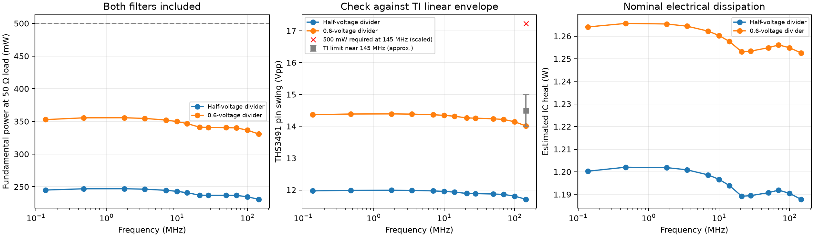

# THS3491 amplifier circuit study

The proposed gain-of-five THS3491DDA circuit with a half-voltage input divider predicts 231–247 mW of fundamental output across 137 kHz–145 MHz with both representative filters included. The 0.6-voltage divider predicts 331–356 mW. These are candidate-circuit calculations, not RF measurements or an implemented PA board.

This circuit does not establish 500 mW across the full range. At 145 MHz the higher-drive case gives 330.6 mW with 14.01 Vpp at the PA output pin. Linear scaling to 500 mW would require approximately 17.2 Vpp, above TI's approximately 14–15 Vpp recommended linear envelope there. Different filter matching or another PA arrangement can change the result; this study does not prove that every THS3491 circuit is limited to these powers.

## Circuit

The unchanged Logic RF Driver circuit includes its directly joined SN74LVC2T45 outputs, Samsung C4 fit, RF_RAW detector, and both LEDs. Its output feeds an inductor-first low-pass filter, a matched loss network, and the input divider. The THS3491DDA uses 798 ohms of feedback and 200 ohms from the inverting input to ground, giving a nominal voltage gain of 4.99. REF is grounded and PD is held at 3.3 V. Supplies are ideal +15 V and −15 V.

The half-voltage divider has 100 ohms from its input to ground, 50 ohms in series to the noninverting input, and 50 ohms from that input to ground. Its nominal input resistance is 50 ohms. The higher-drive divider uses 125 ohms, 33.333 ohms, and 50 ohms, respectively. Input capacitance in TI's model is included.

The amplifier output has a 1-ohm isolation resistor and a 1 µF coupling capacitor with illustrative 0.03-ohm ESR and 0.5 nH ESL. A second inductor-first low-pass filter and a second matched loss network feed the grounded 50-ohm load. There is no 50-ohm series output termination. The small isolation resistor does not establish stability into arbitrary filters or cables.

## Filters and loss assumptions

Each filter is a fifth-order Butterworth L-C-L-C-L ladder designed for 50-ohm terminations, with cutoff at 1.5 times the test frequency. The normalized values are 0.618034, 1.618034, 2, 1.618034, and 0.618034. Every test frequency uses a separately scaled component set; these are representative band-selected filters, not a single filter covering the entire range.

Inductor series loss uses Q = 50 at the test frequency. Parallel winding capacitance is the smaller of 2 pF and the value giving self-resonance at five times cutoff. Capacitor Q is 1000, with 0.3 nH series inductance. Endpoint sensitivities use inductor Q = 25 and 100. These assumptions do not identify suitable actual inductors or guarantee their current rating, self-resonance, or loss.

The nominal matched loss network adds 0.5 dB to each filter's finite-Q loss. Endpoint cases add 0 or 1 dB instead. These networks represent additional dissipative loss; the actual LC networks determine reflection, harmonic loading, and the amplifier's load. Their 50-ohm design impedance does not make the THS3491 output a 50-ohm source.

## Full-band results

The table uses the half-voltage divider, nominal Q, and 0.5 dB of additional loss at each filter. Power is the fundamental at the final 50-ohm load, not total square-wave power. Rail currents are positive draw magnitudes.

| Frequency (MHz) | Load power (mW) | PA pin swing (Vpp) | +15 V / −15 V draw (mA) | IC heat (W) | Logic 5 V pull-up estimate (mA) |
| --- | ---: | ---: | ---: | ---: | ---: | ---: |
| 0.137 | 244.9 | 11.97 | 50.5 / 50.5 | 1.20 | 18.8 |
| 0.475 | 246.9 | 11.99 | 50.6 / 50.7 | 1.20 | 19.3 |
| 1.8 | 246.9 | 11.99 | 50.6 / 50.7 | 1.20 | 19.7 |
| 3.5 | 246.3 | 11.99 | 50.5 / 50.6 | 1.20 | 19.9 |
| 7 | 244.5 | 11.97 | 50.4 / 50.4 | 1.20 | 20.4 |
| 10 | 243.0 | 11.95 | 50.3 / 50.3 | 1.20 | 20.9 |
| 14 | 240.9 | 11.93 | 50.1 / 50.1 | 1.19 | 21.5 |
| 21 | 237.1 | 11.89 | 49.8 / 49.8 | 1.19 | 22.5 |
| 28 | 236.9 | 11.88 | 49.8 / 49.8 | 1.19 | 23.6 |
| 50 | 236.8 | 11.87 | 49.8 / 49.8 | 1.19 | 26.8 |
| 70 | 236.7 | 11.86 | 49.9 / 49.9 | 1.19 | 29.6 |
| 100 | 234.6 | 11.81 | 49.7 / 49.7 | 1.19 | 33.6 |
| 145 | 230.8 | 11.71 | 49.5 / 49.5 | 1.19 | 39.6 |

## Drive and loss sensitivity

The extra-loss column applies to each filter independently, in addition to finite-Q loss. The divider ratio is the voltage fraction at the amplifier input.

| Frequency (MHz) | Extra loss per filter (dB) | Divider ratio | Load power (mW) | PA pin swing (Vpp) | IC heat (W) |
| --- | ---: | ---: | ---: | ---: | ---: |
| 0.137 | 0 | 0.5 | 308.4 | 12.68 | 1.22 |
| 0.137 | 0.5 | 0.5 | 244.9 | 11.97 | 1.20 |
| 0.137 | 1 | 0.5 | 194.6 | 11.30 | 1.18 |
| 0.137 | 0.5 | 0.6 | 352.7 | 14.37 | 1.26 |
| 145 | 0 | 0.5 | 290.1 | 12.39 | 1.21 |
| 145 | 0.5 | 0.5 | 230.8 | 11.71 | 1.19 |
| 145 | 1 | 0.5 | 183.6 | 11.06 | 1.17 |
| 145 | 0.5 | 0.6 | 330.6 | 14.01 | 1.25 |

TI's [maximum recommended output-voltage graph](https://www.ti.com/lit/ds/symlink/ths3491.pdf#page=29) is an independent constraint. Its ±15 V curve permits approximately 14–15 Vpp near 145 MHz. A model result above that envelope does not establish linear operation. The model's 9000 V/µs internal slew parameter also differs from the datasheet's 8000 V/µs typical headline specification. Neither the nominal small-signal bandwidth nor numerical convergence establishes 500 mW at the filtered load.

## Inductor-first and capacitor-first input filters

The capacitor-first sensitivity replaces only the input ladder with C-L-C-L-C using the same normalized values, cutoff, and loss assumptions. The output filter remains inductor-first.

| Frequency (MHz) | Input filter | Load power (mW) | Larger modeled U1 pin peak (mA) | Logic 5 V pull-up estimate (mA) |
| --- | --- | ---: | ---: | ---: |
| 0.137 | L first | 244.9 | 36.4 | 18.8 |
| 0.137 | C first | 333.2 | 327.6 | 30.1 |
| 145 | L first | 230.8 | 35.9 | 39.6 |
| 145 | C first | 309.5 | 62.7 | 47.9 |

The four filter-topology comparisons extract U1 peaks from native adaptive solver samples. The result record also retains four replays of those cases; the largest fundamental-power difference is 0%. Other case peak fields use 2000 uniform samples per period and can miss narrow logic edges, especially at low frequency. Average power and current use the uniform Fourier window.

The pulse-current figures are sensitive to the IBIS-derived switching surrogate and assumed parasitics. They compare loading in this model and do not establish actual pulse-current ratings or a measured U1 defect. A capacitor-first input directly exposes the logic outputs to the filter's shunt capacitance. Inductor-first is the preferred starting topology for this switching source, with actual ringing and current checked on hardware.

## Current draw and heat

TI's [TINA-TI DDA model](https://www.ti.com/lit/zip/SBOMAI5) sets active quiescent current to 16.8 mA and estimates load-dependent supply current. Its GOUTN source has the opposite sign from a physical negative-rail sink-current load. The unmodified model gives 49.49 mA on +15 V and -15.87 mA on −15 V in the 145 MHz control case. That raw negative-rail value cannot support a power or heat estimate.

The working copy changes only the sign of GOUTN's negative-current term. The original download is retained. Changing that sign changes control-case output power by 5.79365e-06%. Independently calculating each rail's current as 16.8 mA plus the corresponding half-wave of total output-pin current agrees within 0.00019768 mA. Total output-pin current includes the feedback branch. This is a documented model correction, not evidence of a hardware defect.

IC heat is supply power minus real power delivered through the output pin, including the external feedback network. The separate filter/isolation loss is external dissipation. The model does not establish additional high-frequency internal losses, temperature-dependent current, converter loss, or real-board cooling.

The nominal circuit predicts 49.5–50.6 mA from +15 V and 49.5–50.7 mA from −15 V. Its THS3491 dissipation is 1.19–1.20 W. The higher-drive divider draws 55.9–57.3 mA from +15 V and 55.9–57.5 mA from −15 V, with 1.25–1.27 W of IC heat. The logic 5 V estimate covers the modeled pull-up currents, including their modeled capacitive load, but omits complete internal crossover and VCCA power. The logic 3.3 V result covers the two LED branches only.

The Logic RF Driver's existing input loads the clock source with approximately 14.64 pF in the existing input-timing surrogate plus R1's 10-kilohm pull-down. The ideal charge-current estimate C × 3.3 V × frequency spans 0.0066–7.01 mA, plus approximately 0.165 mA average through R1 at 50% duty. This is a clock-source load estimate, not measured Pico, Pi, or Si5351 supply current. The PA's divider and filters load U1's output, not those clock pins directly.

At 85% converter efficiency, the nominal ±15 V amplifier power alone corresponds to approximately 349–357 mA from a 5 V converter input. Add the Logic RF Driver's 5 V load and the separately powered 3.3 V circuitry. The higher-drive divider corresponds to 395–405 mA for the PA alone. This is an efficiency assumption; no converter is selected or simulated.

### Thermal estimate

The following temperatures use the largest nominal modeled IC dissipation, steady state, and Tj = Ta + Pd × thermal resistance. TI lists 44.5 °C/W junction-to-ambient for the DDA package on its reference test board. That value is not the thermal resistance of a new two-layer PA PCB. The other rows are illustrative cooling sensitivities. They are not a thermal simulation.

| Assumed junction-to-ambient (°C/W) | Junction at 25 °C ambient (°C) | Junction at 50 °C ambient (°C) |
| --- | ---: | ---: |
| 40 | 73 | 98 |
| 44.5 | 78 | 103 |
| 60 | 97 | 122 |
| 80 | 121 | 146 |
| 100 | 145 | 170 |

Using the largest higher-drive dissipation adds approximately 3 °C to the 44.5 °C/W reference-board estimate. These figures do not include unmodeled high-frequency internal loss.

The exposed pad needs a properly soldered ground connection, thermal vias, and adequate copper or a heatsink. Temperatures must be checked on the actual assembly. The electrical model remains at 25 °C; the thermal estimate is not fed back into its output response.

## Numerical validation and scope

The [result record](docs/ths3491-results.json) contains 41 cases, source/model hashes, and settling checks. Ngspice runs the unencrypted TI DDA model in PSpice compatibility mode with its native XSPICE code models. The signal model is unmodified; the supply-loading correction is explicit. Gear integration uses reltol 0.0001 and abstol 1e-12. Every case runs 60 periods and measures the final eight. The three searched capacitor states change by less than 50 µV over the final 20 periods, and successive four-period power windows differ by less than 0.1%.

Four endpoint checks halve the maximum timestep. The largest power change is 0.002125%, and the largest heat change is 0.0006282%. These checks assess numerical consistency; they do not validate the device or filter models. The macro-model does not claim accurate harmonic distortion, temperature behavior, manufacturing corners, or an extracted PCB response.

The candidate PA is absent from the schematic, PCB, and BOM. The study makes no CAD changes. The [Logic RF Driver model scope](MODEL-SCOPE.md) and [board circuit study](BOARD-SIMULATION.md) describe the source-stage limitations.

## Reproduction

Run `scripts/simulate_ths3491.py` with `--research`, `--output`, and `--board-runs`, then run `scripts/report_ths3491.py` with `--research` and `--runs`. The output directory requires the unmodified TI `THS3491DDA.lib` under `models/`. Board runs require the retained detector-loaded source decks and their Samsung C4 fits. The external research directory supplies the ngspice helper and Python dependencies used by the existing project studies. These retained inputs are required; this is not a self-contained simulator installation. Vendor model text and raw runs remain in ignored `generated/` storage.

The [dual-chip load-sharing study](THS3491-DUAL-STUDY.md) evaluates TI's parallel RGT arrangement with inductor-first input and output filters, including a matched single-RGT control and the published output-resistor networks.
