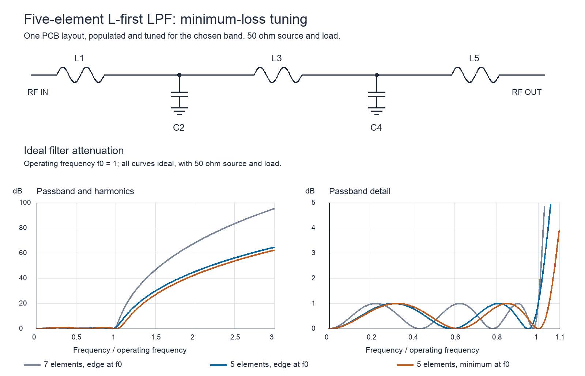

# Five-element tuning for WSPR and QRSS

Study date: 2026-11-22. Extension of the [comparative circuit study](README.md), moved into the independent WsprryPi LPF-LCL project. Calculations use the local [reference workbook snapshot](reference/LPF-Values.xlsx); the original C-first filter topology and values remain unchanged by the Adafruit SMA replacement. All responses assume real 50 Ω source and load.

Place the highest-frequency transmission maximum of the five-element, 1 dB Chebyshev ladder at the center of the combined WSPR/QRSS frequency envelope for each workbook row. This removes ideal mismatch loss near the operating frequencies for a modest reduction in harmonic rejection. It retains the L–C–L–C–L circuit and three coils.



## Tuning method

For the five-element prototype, attenuation is:

`A(f) = 10 log10[1 + (10^0.1 − 1) × T5(f/fp)^2]`

The highest positive root of `T5` is `cos(π/10) = 0.9510565163`. Set:

`f0/fp = 0.9510565163`, or `fp = 1.051462224 × f0`.

Here `f0` is the desired minimum-loss frequency, and `fp` is the 1 dB passband edge. Multiply **every L and C by 0.9510565163**, relative to an edge-tuned design using the same `f0`. The circuit remains a 1 dB-ripple Chebyshev filter, but the operating frequency is at an ideal transmission maximum. The lower positive root at `0.587785 × fp` would move the edge much farther upward and sacrifice more rejection, so the highest root is selected.

The equation follows the Chebyshev response in Michael Steer's [The Chebyshev Lowpass Approximation](https://eng.libretexts.org/Bookshelves/Electrical_Engineering/Electronics/Microwave_and_RF_Design_IV%3A_Modules_%28Steer%29/02%3A_Filters/2.05%3A_The_Chebyshev_Lowpass_Approximation). Root selection, scaling, and all numerical results here are local calculations.

## Harmonic tradeoff

Both cases below are synthesized for the same operating frequency `f0`; components are ideal. This isolates the tuning change from the small frequency differences between workbook columns B/C and the previous column-D edge calculation.

| Quantity | Edge at f0 | Highest transmission maximum at f0 |
| --- | ---: | ---: |
| Filter attenuation at f0 | 1.000 dB | 0.000 dB |
| Filter attenuation at 2f0 | 45.306 dB | 42.767 dB |
| Filter attenuation at 3f0 | 64.666 dB | 62.347 dB |
| Filter attenuation at 4f0 | 77.725 dB | 75.470 dB |
| Filter attenuation at 5f0 | 87.670 dB | 85.443 dB |
| Additional second-harmonic suppression relative to carrier | 44.306 dB | 42.767 dB |
| Additional third-harmonic suppression relative to carrier | 63.666 dB | 62.347 dB |

Absolute attenuation falls **2.539 dB at 2f0** and **2.319 dB at 3f0**. Because carrier transmission improves by 1 dB, suppression relative to the carrier falls only **1.539 dB** and **1.319 dB**, respectively. An ideal square-wave source would give approximately **−71.89 dBc third harmonic** after minimum tuning, versus **−73.21 dBc** with edge tuning. Actual source harmonic levels, impedances, and nonlinearity remain independent inputs.

## WSPR and QRSS coverage

[retune_lpf.py](retune_lpf.py) parses the literal WSPR windows in workbook column B and QRSS windows in column C. Each row's target is the midpoint between the lowest and highest listed frequencies across both modes. A frequency-range entry is treated as a range, not as a single center. No QRSS frequency is invented for the blank 2200 m or 2 m entries.

The resulting study covers 15 WSPR rows and 13 QRSS rows. The largest ideal attenuation anywhere in the listed mode windows is **0.000142 dB**, in the relatively wide combined 630 m envelope. A 201-point sweep checks each mode window and its second and third harmonics. At these narrow offsets around the root, the maximum fundamental attenuation occurs at a window endpoint. Candidate E24 capacitor pairs, with exact tuned inductors and no part tolerances, give a maximum **0.000747 dB** fundamental attenuation across all listed mode windows.

These are workbook-listed frequencies, not a fresh verification of allocations, full amateur bands, or all possible QRSS frequencies. Existing labels such as `30 & 40m` are retained as workbook build identifiers. For that row, the minimum is centered on its listed **30 m** WSPR/QRSS windows; this does not also place 40 m at a transmission maximum. Sharing populated filters across separated bands still requires checking the lower band's harmonic rejection.

### Example: 20 m WSPR and QRSS

The workbook lists WSPR at **14.097000–14.097200 MHz** and QRSS at **14.096800–14.097000 MHz**. Center the minimum at **14.097000 MHz**, giving a passband edge of **14.822463 MHz**.

| Element | Target |
| --- | ---: |
| L1 = L5 | 1.146155 µH |
| L3 | 1.611108 µH |
| C2 = C4 | 234.3134 pF |

A nominal E24 pair of **160 pF + 75 pF** at each capacitor position gives 235 pF. With exact target inductances, this models **0.000734 dB** attenuation at the target and no more than **0.000747 dB** across the combined 20 m windows. These small numbers describe ideal mismatch loss, not achievable total insertion loss or a required tuning precision.

### Per-row targets

The full [minimum-loss component table](minimum-loss-values.csv) includes literal mode bounds, capacitor pairs, and worst-window harmonic attenuation. Target values below are calculations, not component tolerances or finished winding specifications.

| Workbook build | Target minimum | L1 = L5 | L3 | C2 = C4 |
| --- | ---: | ---: | ---: | ---: |
| 2200 m | 137.500 kHz | 117.51 µH | 165.18 µH | 24.023 nF |
| 630 m | 475.900 kHz | 33.951 µH | 47.724 µH | 6.9408 nF |
| 160 m | 1.838000 MHz | 8.7907 µH | 12.357 µH | 1.7971 nF |
| 80 m | 3.570000 MHz | 4.5259 µH | 6.3618 µH | 925.24 pF |
| 60/80 m | 5.288650 MHz | 3.0551 µH | 4.2944 µH | 624.57 pF |
| 40 m | 7.040000 MHz | 2.2951 µH | 3.2261 µH | 469.19 pF |
| 30/40 m | 10.140100 MHz | 1.5934 µH | 2.2398 µH | 325.75 pF |
| 22 m | 13.555475 MHz | 1.1919 µH | 1.6755 µH | 243.67 pF |
| 20/22 m | 14.097000 MHz | 1.1462 µH | 1.6111 µH | 234.31 pF |
| 17 m | 18.106000 MHz | 892.38 nH | 1.2544 µH | 182.43 pF |
| 15/17 m | 21.096000 MHz | 765.90 nH | 1.0766 µH | 156.58 pF |
| 12 m | 24.926000 MHz | 648.21 nH | 911.17 nH | 132.52 pF |
| 10/12 m | 28.125950 MHz | 574.46 nH | 807.50 nH | 117.44 pF |
| 6 m | 50.294400 MHz | 321.26 nH | 451.58 nH | 65.676 pF |
| 2 m | 144.490000 MHz | 111.82 nH | 157.19 nH | 22.861 pF |

## Real component loss and tuning sensitivity

With the existing illustrative model `Rcoil = ωL/Q`, ideal capacitors, and fixed target values:

| Coil assumption | Edge-tuned attenuation at f0 | Minimum-tuned attenuation at f0 |
| --- | ---: | ---: |
| Ideal | 1.000 dB | 0.000 dB |
| Q = 100 | 1.547 dB | 0.457 dB |
| Q = 50 | 2.072 dB | 0.904 dB |

The tuning aligns the **ideal mismatch-loss minimum**. Finite loss shifts the actual transmission maximum somewhat; these values are not an optimization for a measured winding. The normalized results apply to all scaled builds only under the artificial assumption of identical coil Q at every band's operating frequency. They are not component-Q predictions.

A coherent error in all L and C values also shifts the minimum. At f0, common scaling of all components by −1% or +1% gives ideal attenuation **0.024 or 0.029 dB**; −5% or +5% gives **0.387 or 0.939 dB**. Independent component tolerances can also change shape and matching, and are not bounded by this common-scaling illustration. Winding/lead parasitics, capacitor ESR/ESL, coupling, and layout remain outside this model.

This tuning is a useful starting point for separate per-band WSPR/QRSS populations. The next hardware step is to tune and measure the actual assembled filter with 50 Ω ports, then verify the response on its intended amplifier.

## Reproduction and checks

```sh
python3 '/path/to/WsprryPi LPF-LCL/model/retune_lpf.py'
python3 '/path/to/WsprryPi LPF-LCL/model/plot_lpf.py' --minimum-loss
```

Outputs: [minimum-loss-results.json](minimum-loss-results.json), the CSV linked above, and the displayed PNG. The JSON includes the workbook SHA-256, parsed frequency text, both mode windows, exact and rounded responses, finite-Q cases, and common-scaling sensitivity.

Checks: all 15 target points have ideal attenuation within **1.93 × 10⁻¹⁵ dB** of zero and input impedance within **1.93 × 10⁻¹³ Ω** of 50 Ω. Both neighboring frequencies at ±0.1% have higher ideal attenuation. Fundamental-through-fifth-harmonic responses match the independent analytic Chebyshev formula within **2.14 × 10⁻¹⁴ dB**. Frequency parser checks cover centered and explicit-range forms. The original model's reconciliation checks were rerun. The new figure was visually inspected, local Markdown links were checked, and `git diff --check` passed.

These numerical checks are separate from the independent LPF-LCL design's [ERC/DRC and layout validation](../VALIDATION.md). Physical fit and RF results remain unverified.
