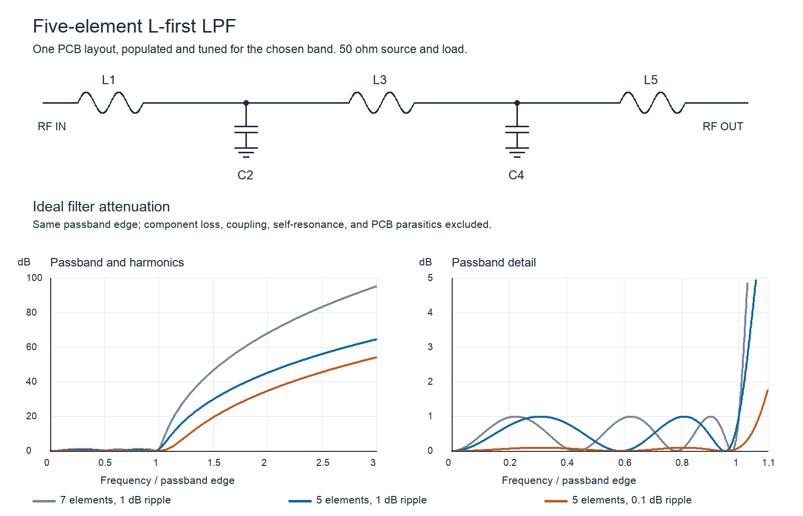

# LPF circuit modeling and L-first alternatives

Study date: 2026-11-22. This comparative study was moved from the original C-first project into the independent WsprryPi LPF-LCL project. The original C-first filter topology and values are unchanged; its SMA launches have subsequently been replaced with Adafruit 1865. The numerical models do not establish RF qualification of either board; see the [new project validation](../VALIDATION.md).

The existing board is a seven-element C–L–C–L–C–L–C ladder. A five-element L–C–L–C–L alternative is a reasonable candidate for a common PCB populated separately for each band. It retains three coils and needs only two shunt-capacitor positions, with two parallel capacitor footprints at each position. Its principal tradeoff is reduced harmonic rejection. A seven-element L-first alternative requires four coils and three capacitor positions.

The follow-up [WSPR/QRSS minimum-loss study](MINIMUM-LOSS.md) moves the five-element filter's highest-frequency transmission maximum onto the combined mode windows. It supplies updated targets and compares carrier loss, harmonic rejection, and coil-Q sensitivity with the edge-tuned version below.



## Sources and assumptions

- The original C-first topology is recorded by the [source manifest](reference/source-manifest.json). Its installed band values come from the independent [workbook snapshot](reference/LPF-Values.xlsx), `LPF Design!A1:Q16`. The workbook is read directly as OOXML and is not modified or recalculated.
- Frequencies are the high-fundamental entries in workbook column D. These are inherited modeling inputs, not independently verified frequency allocations, full-band coverage specifications, or a guarantee of coverage of every QRSS entry in column C.
- Both ports are real 50 Ω. Initial models use ideal lumped components, with no capacitor ESR, lead inductance, coil self-capacitance, mutual coupling, PCB extraction, connectors, or antenna mismatch.
- The existing seven-element values are rounded implementations of a 1 dB Chebyshev design. Their response is calculated from the actual listed values. The proposed five-element designs are synthesized with the column-D frequency as the **passband ripple edge**, not the 3 dB cutoff.
- Standard prototype synthesis follows Michael Steer's [Butterworth and Chebyshev Filters](https://eng.libretexts.org/Bookshelves/Electrical_Engineering/Electronics/Microwave_and_RF_Design_IV%3A_Modules_%28Steer%29/02%3A_Filters/2.07%3A_Butterworth_and_Chebyshev_Filters). Numerical results below are independently calculated by the local model.

## Existing seven-element model

Each series inductor contributes ABCD matrix `[1, jωL; 0, 1]`; each shunt capacitor contributes `[1, 0; jωC, 1]`. Cascading these gives:

`S21 = 2 / (A + B/50 + 50C + D)`

Attenuation is `−20 log10 |S21|`, relative to available source power. For ideal components, passband attenuation represents reflected power, not dissipated heat.

The model reproduces all 15 workbook rows within the workbook's displayed precision: maximum fundamental attenuation difference **0.000459 dB**, maximum 3 dB cutoff difference **0.420 Hz**. For example:

| Workbook build | Frequency | Attenuation at fundamental | At 2f | At 3f | 3 dB cutoff |
| --- | ---: | ---: | ---: | ---: | ---: |
| 2200 m | 137.600 kHz | 1.004 dB | 68.02 dB | 95.12 dB | 139.979 kHz |
| 40 m | 7.040200 MHz | 1.059 dB | 68.02 dB | 95.11 dB | 7.157261 MHz |
| 20/22 m | 14.097200 MHz | 0.982 dB | 68.04 dB | 95.15 dB | 14.343209 MHz |
| 2 m | 144.490100 MHz | 0.376 dB | 67.60 dB | 94.76 dB | 148.279504 MHz |

These large stopband numbers are ideal circuit predictions. They do not establish the assembled board's rejection floor.

## Seven-element L-first equivalent

The exact 50 Ω dual is L–C–L–C–L–C–L, obtained element by element using:

`Lnew [H] = 2500 × Cold [F]`

`Cnew [F] = Lold [H] / 2500`

This preserves complex S21 for ideal equal-impedance terminations. It does **not** preserve input impedance: for the exact dual, `Zin,new = 2500 / Zin,old`. For the 20/22 m row at its fundamental, the existing model gives approximately **112.16 − j42.73 Ω**, and the L-first dual gives **19.46 + j7.42 Ω**. At the third harmonic, they are approximately **−j8.18 Ω** and **+j305.51 Ω**, respectively. Thus, equal transmission response does not imply equal loading of a voltage-driven amplifier.

The [seven-element values table](band-values.csv) supplies exact target inductances/capacitances and candidate E24 parallel capacitor pairs for all rows. Inductances remain measured/tuned targets. The rounded capacitor version is simulated separately from the exact dual in [the numerical results](results.json).

## Five-element proposal

```text
RF IN ── L1 ──┬── L3 ──┬── L5 ── RF OUT
              C2       C4
              │        │
             GND      GND
```

For a five-element, 1 dB Chebyshev filter, normalized values are approximately:

`g = [2.134881, 1.091107, 3.000923, 1.091107, 2.134881]`

Scale series inductors by `50/(2πfp)` and shunt capacitors by `1/(50×2πfp)`. The ideal 3 dB cutoff is **1.033670 × fp**. Merely deleting two elements from the existing design does not produce this filter.

| Circuit, with common passband edge fp | Attenuation at fp | At 2fp | At 3fp |
| --- | ---: | ---: | ---: |
| Seven elements, 1 dB prototype | 1.00 dB | 68.18 dB | 95.29 dB |
| Five elements, 1 dB prototype | 1.00 dB | 45.31 dB | 64.67 dB |
| Five elements, 0.1 dB prototype | 0.10 dB | 34.85 dB | 54.21 dB |

The prototype comparison uses the same ripple-edge frequency. The existing rounded seven-element builds differ slightly, as shown above. Reducing ripple with the same edge sacrifices additional rejection. Raising the passband edge to provide component-tolerance margin also reduces harmonic rejection and requires a new calculation.

For an ideal square-wave source, the third harmonic starts 9.54 dB below the fundamental. The five-element, 1 dB prototype would therefore produce approximately **73.21 dBc third harmonic** under the linear 50 Ω assumptions: `−9.54 − 64.67 + 1.00`. Even harmonics vanish only in the ideal symmetric source. Actual amplifier harmonics, output impedance, and reactive loading must be measured or modeled before selecting the filter order.

### Per-build targets for the 1 dB version

The precision below identifies model targets, not manufacturing tolerances. Both C positions use the same total capacitance. E24 pairs are nominal candidates, with ideal measured/tuned inductors; they are not checked for stock, package fit, voltage rating, or tolerance. Tiny parallel capacitors at VHF can be comparable to layout parasitics.

| Workbook build | L1 = L5 | L3 | C2 = C4 target | Candidate pair at each C position | Rounded model attenuation at fp |
| --- | ---: | ---: | ---: | --- | ---: |
| 2200 m | 123.47 µH | 173.55 µH | 25.241 nF | 24 nF + 1.2 nF | 0.962 dB |
| 630 m | 35.706 µH | 50.190 µH | 7.2995 nF | 6.2 nF + 1.1 nF | 1.002 dB |
| 160 m | 9.2421 µH | 12.991 µH | 1.8894 nF | 1.5 nF + 390 pF | 1.008 dB |
| 80 m | 4.7585 µH | 6.6889 µH | 972.80 pF | 910 pF + 62 pF | 0.980 dB |
| 60/80 m | 3.2122 µH | 4.5153 µH | 656.69 pF | 620 pF + 36 pF | 0.975 dB |
| 40 m | 2.4131 µH | 3.3920 µH | 493.32 pF | 470 pF + 24 pF | 1.033 dB |
| 30/40 m | 1.6754 µH | 2.3550 µH | 342.50 pF | 300 pF + 43 pF | 1.035 dB |
| 22 m | 1.2533 µH | 1.7617 µH | 256.21 pF | 200 pF + 56 pF | 0.980 dB |
| 20/22 m | 1.2051 µH | 1.6940 µH | 246.37 pF | 240 pF + 6.2 pF | 0.984 dB |
| 17 m | 938.29 nH | 1.3189 µH | 191.82 pF | 130 pF + 62 pF | 1.023 dB |
| 15/17 m | 805.30 nH | 1.1320 µH | 164.63 pF | 160 pF + 4.7 pF | 1.010 dB |
| 12 m | 681.57 nH | 958.05 nH | 139.34 pF | 130 pF + 9.1 pF | 0.960 dB |
| 10/12 m | 604.02 nH | 849.05 nH | 123.48 pF | 120 pF + 3.6 pF | 1.023 dB |
| 6 m | 337.79 nH | 474.81 nH | 69.055 pF | 68 pF + 1.1 pF | 1.016 dB |
| 2 m | 117.58 nH | 165.27 nH | 24.037 pF | 24 pF | 0.964 dB |

The [machine-readable five-element table](five-element-values.csv) includes both ripple choices and rounded-component second- and third-harmonic attenuation. The same populated filter cannot simultaneously provide the above per-band responses across the full frequency range.

### Shared-band builds

At the lower band's workbook frequency, an ideal five-element, 1 dB filter designed for the higher band gives:

| Populated build | Lower band checked | Attenuation at lower-band fundamental | At its second harmonic | At its third harmonic |
| --- | --- | ---: | ---: | ---: |
| 60/80 m | 80 m | 0.31 dB | 23.49 dB | 45.93 dB |
| 30/40 m | 40 m | 0.44 dB | 25.27 dB | 47.33 dB |
| 20/22 m | 22 m | 0.04 dB | 43.33 dB | 62.86 dB |
| 15/17 m | 17 m | 0.83 dB | 37.41 dB | 57.55 dB |
| 10/12 m | 12 m | 0.58 dB | 39.11 dB | 59.06 dB |

One generic board populated individually for each band is a stronger starting point than assuming all existing paired-band builds can retain adequate rejection with five elements. These are filter attenuations, not final emissions levels or compliance findings.

## Component loss and common-board feasibility

An illustrative constant-Q model gives every coil series resistance `R = ωL/Q`, leaving capacitors ideal. For the 20/22 m row:

| Circuit | Ideal fundamental attenuation | With coil Q = 100 | With coil Q = 50 |
| --- | ---: | ---: | ---: |
| Existing seven-element C-first | 0.982 dB | 1.999 dB | 2.934 dB |
| Exact seven-element L-first dual | 0.982 dB | 2.017 dB | 2.978 dB |
| Five-element L-first, 1 dB | 1.000 dB | 1.547 dB | 2.072 dB |
| Five-element L-first, 0.1 dB | 0.100 dB | 0.396 dB | 0.689 dB |

These are sensitivity cases, not predictions of a chosen core/winding. The extra seventh-order coil does not by itself imply a large loss penalty: element currents and stored energy matter. Five elements reduce modeled loss here, but require checking the amplifier load as well as S21.

For a proposed board, retain the native header pinout and 33.02 mm spacing, and the optional SMA interface if needed. Provide three series-inductor sites and two shunt positions with paired capacitor footprints and short ground returns. Retain a continuous ground reference and control direct input-to-output coupling. Coil orientation and spacing require layout review. There is no DC blocking in either ladder.

The existing board has three coil sites, but converting it is a routing/topology change, not simply depopulating two capacitors. Mechanical compatibility, connector envelopes, and single-board fit across every band are unproven. The five-element LF targets reach **123–174 µH**, substantially above the existing 65–68 µH 2200 m targets. The workbook's existing turn-count table therefore does not apply. LF winding size, Q, self-resonance, and power handling may determine the board dimensions. At 2 m, use a suitably compact implementation and characterize the complete assembly at RF; matching the nominal inductance at low frequency is insufficient.

## Reproduction and validation

From any working directory:

```sh
python3 '/path/to/WsprryPi LPF-LCL/model/model_lpf.py'
python3 '/path/to/WsprryPi LPF-LCL/model/plot_lpf.py'
```

The model uses Python's standard library. The plot additionally requires Pillow and currently uses the macOS Arial font. Outputs are [results.json](results.json), the two CSV tables, and the displayed PNG. JSON retains SHA-256 hashes of the original C-first workbook, schematic, and PCB from the source manifest; the calculation reads and verifies the local workbook snapshot. No sibling project is needed to reproduce these calculations.

Checks completed:

- All 15 installed-value responses reconcile to the workbook within its displayed precision.
- Complex S21 of the exact seven-element dual agrees across 401 logarithmically spaced frequencies per band, from 0.01f to 10f. Maximum error: **2.28 × 10⁻¹⁵**.
- Existing ideal ladder power conservation, `|S11|² + |S21|² = 1`, agrees within **2.23 × 10⁻¹⁵**.
- Five- and seven-element synthesized ladders independently agree with analytic Chebyshev attenuation across 300 frequencies per prototype within **2.85 × 10⁻¹⁴ dB**.
- The circuit illustration and response figure were visually inspected. Local Markdown links and `git diff --check` were checked.

The modeling checks above are separate from the implemented LPF-LCL project's [ERC/DRC and layout validation](../VALIDATION.md). Physical assembly, actual component Q/tolerances, amplifier stability/loading, thermal behavior, VNA response, and emitted harmonics remain unverified.
